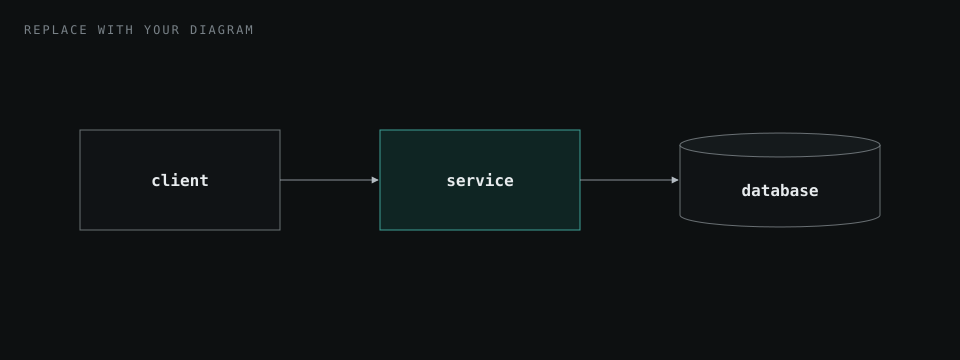
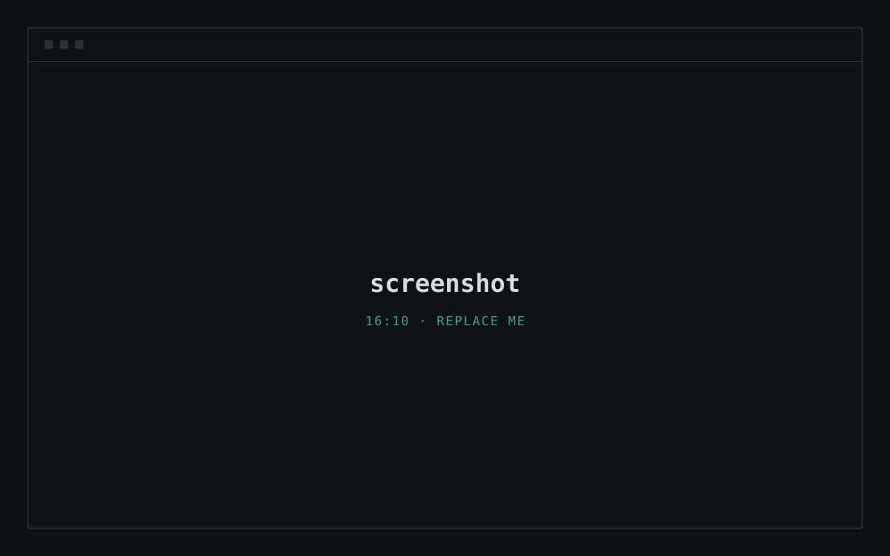

---
# ============================================================================
# PROJECT CASE STUDY (MARKDOWN)
# ============================================================================
# Write the case study here instead of in index.html, then ask Claude to
# generate the page:  "generate projects/<slug>/index.html from _case-study.md"
# That writes index.html and adds (or updates) the card on projects.html.
#
# The slug is the folder name, e.g. projects/weather-station/ -> weather-station.
# The file name starts with an underscore so GitHub Pages never publishes it.
#
# Prose fields use ">" so you can write freely on the lines below,
# including colons. Everything after the second "---" is the page body;
# the guide to the extra blocks is in the comment just below it.
# ============================================================================

# ---- page header -----------------------------------------------------------
title: Project Title
kicker: Case study · Course, client or context
description: >                # one sentence for search results and link previews
  One sentence describing the project.
summary: >                    # the intro paragraph under the title
  Two or three sentences that a recruiter could read on their own: what you built,
  who it is for, and the most interesting thing about how it works.
tech:
  key: [Main tech]            # highlighted chips
  other: [Tech, Tech, Tech]
links:                        # delete any you do not have
  - text: live demo
    url: https://example.com
    primary: true             # the highlighted button
  - text: source code
    url: https://github.com/Malee-Fonseka

# ---- card on projects.html ---------------------------------------------------
card:
  year: 2026
  status: complete            # complete | in progress | archived
  description: >
    One or two sentences: what it is and why it is interesting.
  area: software systems      # ai | data engineering | software systems | research | other
  tech:                       # optional shorter stack; delete to reuse the one above
    key: [Main tech]
    other: [Tech, Tech]
---

<!--
  ============================================================================
  WRITING THE BODY
  ============================================================================
  Normal Markdown works: paragraphs, **bold**, *italic*, `code`, [links](url),
  bullet and numbered lists, > quotes, ### sub-headings and tables.
  Comments like this one are notes to yourself and are left out of the page.

  ## Heading        Starts a numbered section and adds it to the contents.
                    The id comes from the heading ("The problem" becomes
                    the-problem). Set your own with:  ## The problem {#problem}
                    Don't use a single # heading: the title is set above.

     A figure. Write the alt text as a sentence
  *Caption.*                     describing the image. The italic line directly
                                 below is the caption. Add {pad} straight after
                                 the image for padding (good for diagrams).
                                 Readers can click any figure to open it full size.

  Extra blocks start with ::: name and end with a line of just ::: .

  ::: metrics           A row of key numbers. 2 to 4 read best.
  - **42%** what the number measures
  :::

  ::: note              A note callout. Change the label with  ::: note "heads up"
  Text the reader should not miss.
  :::

  ::: decision          A design decision box. Items written as **term:** text
  - **context:** ...    become a labelled list; anything else stays as paragraphs.
  :::                   Change the label with  ::: decision "decision record"

  ::: flow              A step-by-step flow diagram; arrows are added for you.
  1. **Step** detail    3 to 5 steps fit best. Add {key} to the end of a step
  :::                   to highlight it. Put an *italic caption* directly below.
  *Caption.*

  ::: gallery           Several figures side by side. Separate them with a
             blank line, each with its caption below it.
  *Caption.*
  :::

  ```js title="path/to/file.js"      A code listing with a filename header.
  ```                                The right-hand label is the language;
                                     change it with  label="js · excerpt"
                                     Write code as-is: no escaping needed.

  Anything Markdown can't express: write the HTML right here; it is copied as-is.
  Section, figure and contents numbers are added automatically.
  ============================================================================
-->

## Overview

What the project is and why it exists. Keep it to a short paragraph or two.

::: metrics
- **00** what this number measures
- **00%** what this number measures
- **0x** what this number measures
:::

## The problem {#problem}

Who had the problem, what it cost them, and why existing solutions were not good enough.

- A constraint or requirement.
- Another constraint or requirement.

::: note
Use a callout for context the reader should not miss.
:::

## Architecture

How the system is put together and why it is shaped that way.

<!-- Export diagrams from draw.io, Excalidraw, Figma etc. as SVG or PNG. -->

*What the diagram shows and what to notice in it.*

::: decision
- **context:** The situation that forced a choice.
- **decision:** What you chose.
- **trade-off:** What you gained and what it cost.
:::

## Implementation

The interesting parts of the build. Use sub-headings to split it up.

::: flow
1. **Step one** what happens here
2. **Step two** the important step {key}
3. **Step three** what happens here
:::
*What the flow shows.*

### A sub-heading

Explain one component or decision. Inline code looks like `this`.

```js title="path/to/file.js"
// Paste a short, meaningful excerpt.
function example(input) {
  return input * 2;
}
```

| column | column | column |
| --- | --- | --- |
| value | value | value |
| value | value | value |

## Results

What the project achieved. Numbers, feedback, screenshots of the finished product.

::: gallery

*Caption for this screenshot.*


*Caption for this screenshot.*
:::

## What I learned {#lessons}

- A lesson, and how it changed the way you work.
- Something you would do differently next time.
