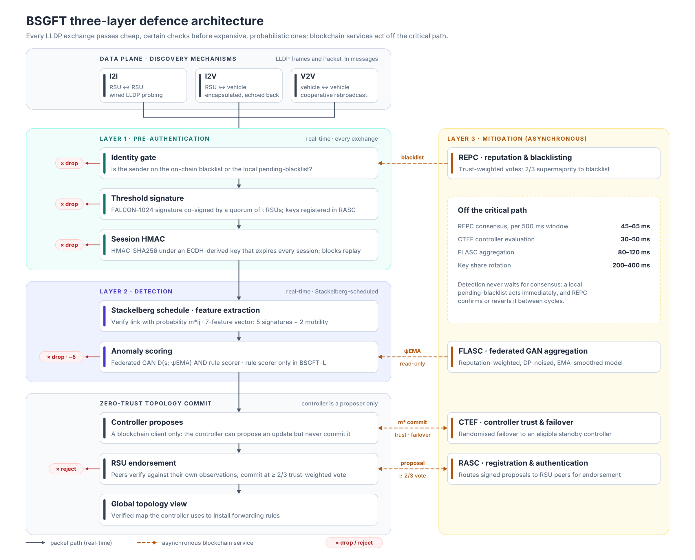
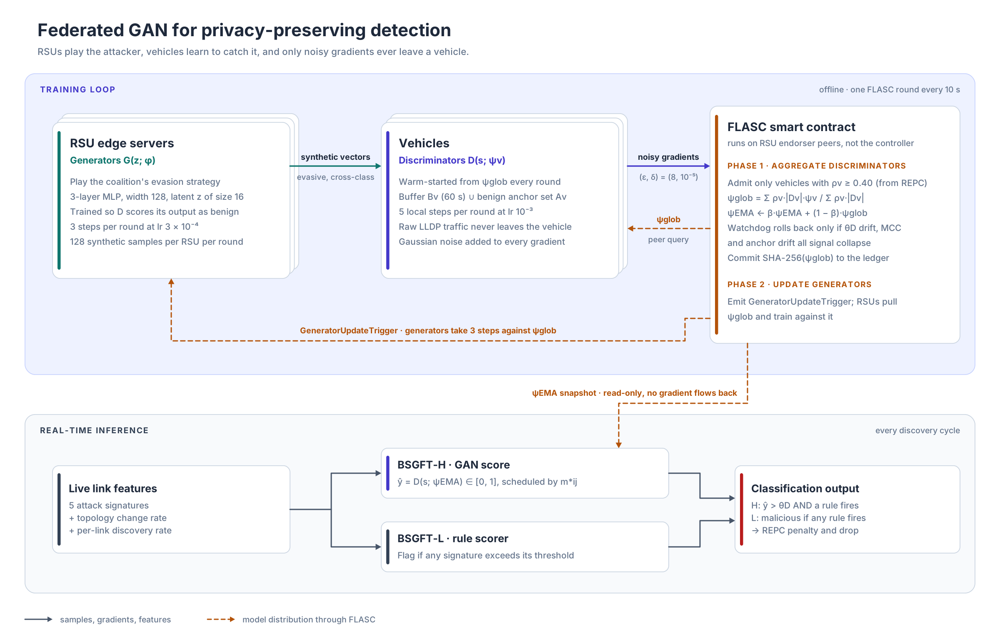
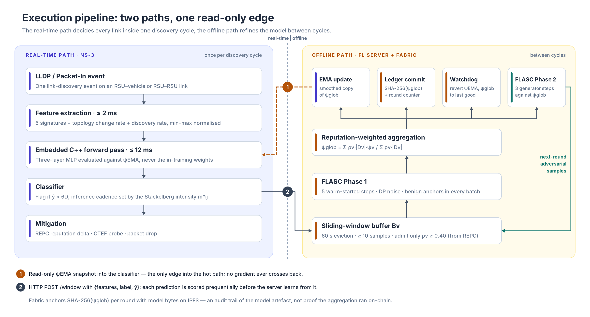
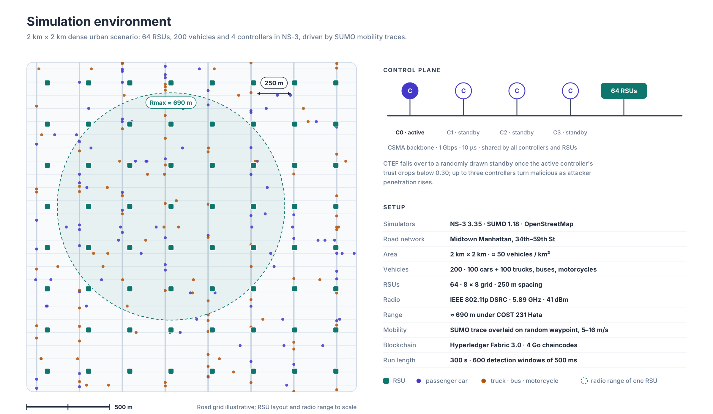
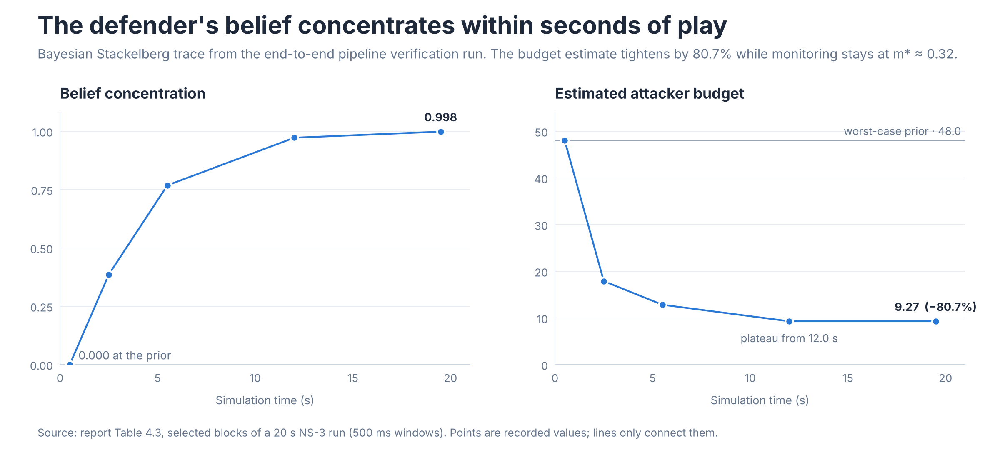
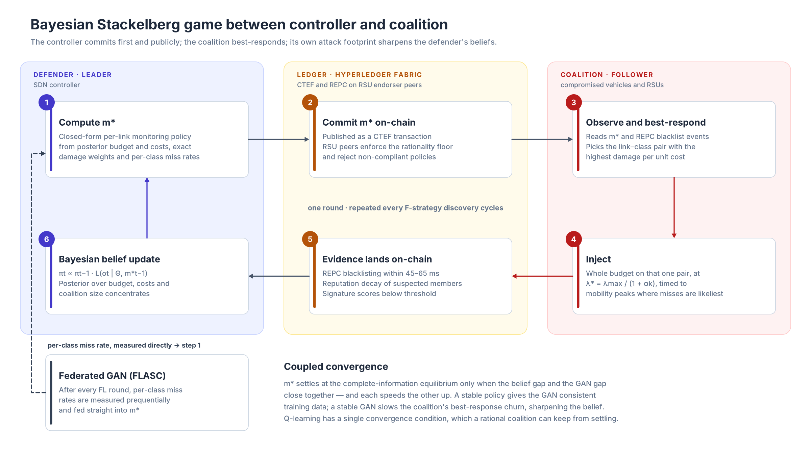

---
# ============================================================================
# PROJECT CASE STUDY · BSGFT
# Edit the case study here, then ask Claude to
# "generate projects/bsgft/index.html from _case-study.md".
# The guide to the extra blocks is in projects/_template/_case-study.md.
# ============================================================================

# ---- page header -----------------------------------------------------------
title: BSGFT — Securing Vehicular Network Topology Against Rational Attackers
kicker: Case study · Final-year research project, University of Ruhuna
description: >
  A blockchain, game-theory and federated-GAN defence framework that protects the SDN
  controller's topology view in software-defined vehicular edge networks from link discovery attacks.
summary: >
  BSGFT is a zero-trust defence framework for Software-Defined Vehicular Edge Networks (SD-VENs),
  where the SDN controller builds its map of the network from unauthenticated LLDP discovery packets.
  It treats attackers as a rational coalition rather than random noise: the controller commits to a
  game-theoretic monitoring policy on a permissioned blockchain, RSU-hosted GAN generators play the
  attacker's evasion strategy against vehicle-hosted discriminators, and post-quantum signatures,
  reputation consensus and controller failover close the remaining trust gaps. The full system was
  built and evaluated in NS-3 with SUMO mobility traces over a live Hyperledger Fabric network.
tech:
  key: [NS-3, Hyperledger Fabric, PyTorch, SUMO]
  other: [Go chaincode, C++, Python, liboqs FALCON-1024, Kyber-1024, IPFS, OpenStreetMap, Game theory, Federated learning]
links:
  - text: source code
    url: https://github.com/Malee-Fonseka
    primary: true

# ---- card on projects.html ---------------------------------------------------
card:
  year: 2026
  status: complete
  description: >
    A zero-trust defence against link discovery attacks in vehicular edge networks, combining a
    Bayesian Stackelberg game, a federated GAN, four smart contracts and post-quantum signatures.
  area: research
  tech:
    key: [NS-3, Hyperledger Fabric, PyTorch]
    other: [SUMO, Go, Game theory]
---

## Overview

Modern intelligent transport systems are moving control logic out of the cloud and onto the road edge. In a **Software-Defined Vehicular Edge Network (SD-VEN)**, Road Side Units (RSUs) host edge servers, vehicles connect to them over DSRC, and a central SDN controller decides how every packet is routed. That controller is only as good as its map of the network — and it builds that map from **LLDP link discovery packets that are neither authenticated nor integrity-protected**.

BSGFT (*Blockchain-based Stackelberg Game-theoretic Federated AI agent with Threshold signatures*) is our final-year research project: a defence framework that makes topology discovery zero-trust across all three layers of an SD-VEN — infrastructure-to-infrastructure (I2I), vehicle-to-infrastructure (V2I) and vehicle-to-vehicle (V2V). Its defining idea is to stop treating the attacker as a static threat. BSGFT models compromised vehicles and RSUs as a **rational coalition** that watches the defence and optimises against it, and then designs the defence around that model.

::: metrics
- **~10⁴×** larger attack surface in SD-VENs than in static SDN, derived from the mobility amplification model
- **0.983** MCC for hybrid detection with the Stackelberg policy under a rational coalition (diagnostic run, 60% penetration)
- **157 / 157** on-chain federated-GAN rounds completed with zero collapse rollbacks
- **80.7%** tightening of the defender's estimate of the attacker's budget within 12 s of play
:::

::: note "project context"
Group 61 final-year project (four engineers), Department of Electrical and Information Engineering, Faculty of Engineering, University of Ruhuna, supervised by Dr. P.A.D.S.N. Wijesekara. The scope is simulation-based: every mechanism is designed, implemented and validated in NS-3, with no hardware deployment.
:::

## The problem {#problem}

### Why topology discovery is the weak point

In an SD-VEN the controller accepts every LLDP packet it receives and writes the link it describes straight into its topology database. An attacker who can inject, alter or replay these packets can make the controller believe in links that do not exist, or forget links that do. The consequence is **topology poisoning**: the controller installs forwarding rules for a network that is not physically there. Prior work on SDN-enabled vehicular networks reports blackhole routing causing connectivity losses as high as 79%.

In a vehicular network this is a safety problem, not just an availability problem. Misrouted safety messages, broken cooperative-driving sessions and autonomous navigation decisions made on a false map all put passengers at risk.

### Why vehicles make it worse

Discovery in an SD-VEN runs as three parallel mechanisms, each one a separate attack surface:

- **I2I (wired backbone):** the controller probes RSUs with LLDP inside OpenFlow Packet-Out messages and correlates the Packet-In replies. Links are stable, so probing pauses once the backbone is mapped.
- **I2V (access layer):** an RSU wraps LLDP in a wireless frame, the vehicle mirrors it back, and the RSU forwards it to the controller as proof of attachment.
- **V2V (dynamic edge):** a vehicle cooperatively rebroadcasts an LLDP frame, neighbours that overhear it report back through their RSUs, and the controller infers a peer-to-peer link.

All three run on an *open trust* model. A single compromised RSU is especially dangerous because it is both a traffic hub and the controller's "eyes" at the edge — whatever it reports upstream becomes the controller's truth.

Mobility amplifies everything. Every link expiry triggers a fresh discovery cycle, so the number of discovery exchanges — and therefore attack opportunities — scales with vehicle speed and inversely with radio range. Worse, a vehicle legitimately driving out of range looks exactly like an attacker erasing a link, so any fixed detection threshold misses more attacks as the network churns.

### Measured impact without a defence

Before building any mitigation, we ran each attack against the unprotected open-trust discovery process in NS-3:

| Attack | 0% malicious | 25% | 50% | 75% |
| --- | --- | --- | --- | --- |
| Link fabrication — Topology Integrity Ratio | 1.00 | 0.93 | 0.86 | 0.79 |
| MiTM / replay — Topology Integrity Ratio | 1.00 | 0.93 | 0.86 | 0.79 |
| Flooding — Link Discovery Latency | 5.000 ms | — | — | 5.013 ms |

Topology integrity falls linearly with attacker penetration: every compromised node contributes a proportional volume of forged or replayed links that the controller accepts unconditionally. Replayed frames poison the map exactly as effectively as freshly fabricated ones. Flooding barely moves latency in this setting; its damage shows up in throughput and topology accuracy instead.

### Why existing defences fall short

A systematic review of twelve link discovery defences — from TopoGuard and its successors to ML-based verifiers and the most comprehensive prior work, BQLLDA (blockchain + Q-learning + post-quantum crypto in a flat SDVN) — exposed five gaps:

- **G1 — No mobility model.** SDN defences assume quasi-static links; none quantifies how link churn scales the attack surface.
- **G2 — V2V and V2I ignored.** No defence protects discovery on the two most volatile layers of the topology.
- **G3 — No rational attacker.** Every defence is reactive and models attackers as static or independent. None models a coalition that jointly chooses attack class, target, timing and intensity in response to the defence — which is exactly how a Q-learning defence can be kept permanently non-converged.
- **G4 — Centralised detection.** ML defences collect raw traffic centrally, exposing topology data and creating a single poisoning target.
- **G5 — No threshold post-quantum crypto.** The only post-quantum LDA defence signs per node, so one compromised RSU can still forge valid updates; and no work offers a lightweight mode with quantified trade-offs.

Most of these defences also assume a **trusted controller** — leaving the highest-value target in the network entirely unverified.

| Capability | TopoGuard | LINK-GUARD | RLV | Wang et al. | BQLLDA | **BSGFT** |
| --- | --- | --- | --- | --- | --- | --- |
| Vehicular mobility modelled | ✗ | ✗ | ✗ | partial | partial | **✓** |
| V2V link integrity | ✗ | ✗ | ✗ | ✗ | ✗ | **✓** |
| Malicious controller | ✗ | ✗ | ✗ | ✗ | ✓ | **✓** |
| Blockchain trust | ✗ | ✗ | ✗ | ✗ | ✓ | **✓** |
| Game-theoretic defence | ✗ | ✗ | ✗ | ✗ | ✗ | **✓** |
| Post-quantum crypto | ✗ | ✗ | ✗ | ✗ | per-node | **threshold** |
| Federated learning | ✗ | ✗ | ✗ | ✗ | ✗ | **✓ (GAN)** |
| Dual deployment mode | ✗ | ✗ | partial | ✗ | ✓ | **✓** |

## Research objectives {#objectives}

The project set three objectives:

1. **Model the threat.** Build comprehensive threat scenarios for LLDP-based discovery across V2V, V2I and I2I, including compromised controllers.
2. **Design the defence.** Develop a blockchain-based, game-theoretic, federated AI framework with GAN-based adversarial traffic synthesis that hinders link discovery attacks from intelligent adversaries.
3. **Evaluate it.** Simulate the framework in NS-3 and compare it against existing SD-VEN defences on attack resistance, adaptability and robustness.

These broke down into seven research questions, each tied to a specific experiment:

| | Question | Evaluated by |
| --- | --- | --- |
| RQ1 | Does the mobility amplification model predict how link churn inflates attack rate and miss probability, and does mobility-aware detection hold up at highway speeds? | E2 — speed sweep |
| RQ2 | Does the Perfect Bayesian Equilibrium policy keep detection quality and resilience against a rational coalition better than uniform monitoring and Q-learning? | E1, E4 — penetration and attacker-rationality sweeps |
| RQ3 | Does the federated GAN catch hybrid and zero-day patterns that rule-based and centrally trained detectors miss? | E1, E5, ablations |
| RQ4 | Can the (t, n) FALCON-1024 threshold scheme tolerate t−1 compromised signers while keeping discovery latency under 100 ms? | Cryptographic quorum ablation |
| RQ5 | Does the lightweight mode cut computational cost by ≥70% while keeping MCC above 0.88 and false positives below 10%? | E1–E3 |
| RQ6 | Does overhead scale sub-linearly with fleet size, and does LKH re-keying scale as O(log N)? | E3, key-management ablation |
| RQ7 | Does class-aware monitoring stay stable when the coalition concentrates on its best attack class, and do the game policy and GAN converge jointly? | E5 — coalition class composition |

## Threat model {#threat-model}

The adversary is defined in two layers: **capability axioms** (what the attacker can do) and **behavioural axioms** (how a rational coalition uses those capabilities). Each behavioural axiom maps directly to a defence component, which is what keeps the architecture from being a pile of unrelated mechanisms.

| Axiom | Definition |
| --- | --- |
| C1 Node compromise | Insider vehicles and RSUs holding valid credentials |
| C2 Traffic manipulation | Intercept, modify, inject and replay OpenFlow, LLDP and CAM messages |
| C3 Tunnelling | Colluding nodes build out-of-band wormholes between distant segments |
| C4 Resource exhaustion | High-rate table-miss floods against controller CPU and memory |
| C5 Controller compromise | Some controller instances replay or originate falsified control messages |
| C6 Coalition formation | Compromised nodes act as one strategic agent with a pooled resource budget |
| **B1 Strategic rationality** | Reads the defence policy on-chain and jointly optimises timing, target link, attack class, intensity and resource allocation → motivates the **Stackelberg game** |
| **B2 Tactical adaptation** | Estimates its own miss rate from public signals and shifts its traffic distribution below the detector's boundary → motivates the **adversarial GAN** |
| **B3 Strategic–tactical coupling** | B1 and B2 feed each other through the shared per-class miss probability → motivates **coupled convergence** |

Three attack classes are considered on every layer: **link fabrication** (forged chassis IDs creating ghost links), **Packet-In flooding** on the data and control planes (including malicious controllers and RSUs), and **MiTM / replay** (valid packets captured and replayed to fake links that no longer exist).

### The mobility amplification model

The first contribution is a closed-form model of how mobility inflates the attack surface. With link lifetime τ defined as the time until two nodes drift beyond radio range (≈690 m for DSRC at 5.89 GHz under the COST 231 Hata model), discovery frequency per link is 1/E[τ], and the expected attack rate is the per-exchange success probability multiplied by the network-wide discovery rate.

Because the attacker's per-exchange capability cancels out, the ratio of attack rates between an SD-VEN and a static SDN collapses to a ratio of link lifetimes:

**Φmob = E[τSDN] / E[τSD-VEN] ∝ (v̄ / Rmax) · E[τSDN]**

With wired links lasting on the order of 10⁵ s and vehicular links on the order of 10 s, Φmob is around **10⁴** — the SD-VEN presents an attack surface four orders of magnitude larger than static SDN.

A second result captures the detection ambiguity: the false-negative probability of any static threshold becomes the static-SDN miss rate *plus* a term that grows linearly with the topology change rate. That single equation drove three design choices — retrain the discriminator at a cadence tied to churn, scale monitoring effort with the discovery rate, and adapt discovery timing so the coalition cannot predict its injection windows.

## Architecture

BSGFT separates **detection** from **mitigation** and orders its defences so that cheap, certain checks run before expensive, probabilistic ones.

{pad}
*The three-layer defence. Cryptography removes forged and replayed packets before any model runs; reputation and failover act asynchronously so they never stall discovery.*

::: flow
1. **Pre-authentication** FALCON-1024 threshold signature and time-limited session HMAC on every LLDP exchange; forged or expired packets are dropped
2. **Detection** Stackelberg-scheduled scoring of a 7-feature vector by the federated GAN discriminator (or the rule-based scorer in lightweight mode) {key}
3. **Mitigation** REPC reputation updates and blacklisting, CTEF controller trust scoring and failover, run between discovery cycles
4. **Zero-trust commit** Every controller topology proposal needs a two-thirds weighted RSU endorsement before it enters the global view
:::
*The per-cycle pipeline. Only the first two stages sit on the real-time path.*

::: decision "decision record — the controller as proposer"
- **context:** Most prior work trusts the controller, yet it is the single most valuable target in the network, and a compromised controller can poison the topology without touching a single LLDP packet.
- **decision:** Demote the controller to a client of the blockchain. It can propose link-state changes, but RSU endorser peers verify each proposal against their own observations and only a two-thirds trust-weighted supermajority commits it.
- **trade-off:** Eliminates the controller as a single point of failure for every attack variant, at the cost of consensus latency on topology commits — which is why consensus runs asynchronously and a local pending-blacklist gives immediate protection in the meantime.
:::

### Who does what

The framework deliberately maps each role onto the SD-VEN hardware hierarchy:

| Component | Runs on | Role |
| --- | --- | --- |
| GAN generators | RSU edge servers | Synthesise adversarial LLDP feature vectors — the coalition's evasion strategy |
| GAN discriminators | Vehicles | Score local link traffic without ever transmitting raw LLDP streams |
| Four smart contracts | RSU endorser peers | Authentication, reputation, controller trust and federated aggregation |
| Threshold signing committee | n RSUs | Jointly co-sign link-state updates; no single RSU holds the key |
| SDN controller | Client node only | Proposes topology and commits the monitoring policy; holds no endorser or orderer role |

### Two deployment modes

Vehicle On-Board Units range from capable to severely constrained, so BSGFT ships as two modes that share one architecture.

| Dimension | BSGFT-H (full security) | BSGFT-L (lightweight) |
| --- | --- | --- |
| Authentication | FALCON-1024 (t, n) threshold signatures, Kyber-1024 share distribution | HMAC-SHA256 with a controller-issued unicast key |
| Key management | DH-integrated Logical Key Hierarchy, O(log N) re-keying | Unicast, O(N) re-keying |
| Detection | Federated GAN discriminator | Rule-based signature scorer |
| Monitoring policy | Closed-form Stackelberg equilibrium per link | Binary: monitor only what the rules flag |
| Blockchain | RASC + REPC + CTEF + FLASC | REPC only |
| Intended for | Safety-critical deployments | Resource-constrained OBUs; design target ≥70% lower complexity |

::: decision "decision record — two modes instead of one"
- **context:** A single full-security pipeline would price constrained OBUs out of the network; a single lightweight one would leave safety-critical services exposed to cross-class evasion that rules cannot see.
- **decision:** Keep one feature vector, one reputation layer and one decision interface, and swap the expensive components per mode.
- **trade-off:** The lightweight mode is structurally blind to hybrid attacks that stay below every individual threshold — a gap the evaluation measures explicitly (cross-class evasion rate) rather than hides.
:::

## Methodology {#methodology}

### Attack signatures and the feature vector

Five measurable signatures are extracted per link over a 500 ms sliding window. Each is shaped so that benign traffic scores at or below zero and the value reads as evidence directly.

| Signature | Targets | What it measures |
| --- | --- | --- |
| Inter-arrival timing anomaly | Fabrication | Mean squared relative deviation of LLDP arrivals from the mobility-predicted interval — forged frames arrive faster than mobility can produce them |
| Per-port packet rate | Flooding | Fractional excess of the busiest port over the protocol's own ceiling |
| Source identity consistency | MiTM / replay | Number of distinct chassis IDs seen on one link, minus one — an exact count of impostors |
| Port-state transition | Combined fabrication + relay | KL divergence of observed port-state time shares from the legitimate profile |
| Controller Packet-Out anomaly | Malicious controller | Packet-Outs for links absent from ground truth, plus excess Packet-Out rate, measured by independent probe nodes |

Two mobility-context features — topology change rate and per-link discovery frequency — are appended to form a **7-dimensional vector**. The lightweight scorer flags a link if *any* signature exceeds its threshold (high recall, near-zero cost); the GAN discriminator reads all seven features jointly and outputs a continuous score.

### Bayesian Stackelberg game

The controller (leader) commits to a monitoring intensity for every link — the probability of actively verifying it each cycle — under a fixed control-plane overhead budget. The commitment is written **on-chain through CTEF**, so the coalition (follower) can read it exactly and best-respond.

Publishing the defence sounds counter-intuitive, but it is the point of a Stackelberg formulation: a credible, observable commitment guarantees the defender at least the utility of any simultaneous-move equilibrium, and it forces a rational attacker into a predictable best response the defender can plan against.

::: flow
1. **Commit** Controller publishes the monitoring vector m* on-chain
2. **Observe** Coalition reads m* and recent blacklisting events
3. **Best-respond** Coalition concentrates its whole budget on the single link–attack-class pair with the highest damage per unit cost {key}
4. **Update beliefs** Defender updates its posterior over the coalition's hidden budget and costs from four evidence streams
5. **Recompute** A new closed-form m* is committed every strategy cycle
:::
*One round of the game. The coalition's own attack footprint is the evidence that sharpens the defender's beliefs.*

Several modelling choices make the game realistic rather than decorative:

- **Class-specific costs and damage.** Flooding is cheap with no fixed cost; fabrication carries the cost of holding a compromised RSU; MiTM pays for positioning and a wormhole tunnel. Damage is computed from the controller's own topology — betweenness centrality for fabrication, share of discovery load for flooding, share of the fleet's safety-critical routes for MiTM.
- **Optimal intensity below capacity.** A success function that rises with injection rate and then collapses as detection becomes certain gives each class an optimal intensity strictly below its physical maximum — a rational attacker throttles itself.
- **Closed-form solution.** The follower problem decomposes into an independent per-class intensity choice and a linear budget allocation that always lands on a single link–class pair. Substituting it back and solving the KKT conditions yields a **closed-form per-link monitoring policy**: monitoring rises with worst-case damage, attacker budget and peak miss probability, and falls with verification cost. Links whose expected damage is not worth their verification cost are deliberately left unmonitored.
- **Peak, not mean, miss probability.** Because the coalition times injections to mobility peaks, the policy is calibrated against the worst topology-change rate in each window.
- **Rationality floor against a malicious controller.** A compromised controller could commit "monitor nothing". RSU peers reject any committed policy that does not give high-damage links proportionally more monitoring, and keep enforcing the last valid one.

The defender cannot see the coalition's budget or costs, so the solution concept is a **Perfect Bayesian Equilibrium**: the policy is optimal under the current belief at every round and converges to the complete-information Subgame Perfect Nash Equilibrium as the belief concentrates. The prior is anchored at worst-case capability bounds, so the policy is conservative from the first round.

The most novel theoretical result is **coupled convergence**. The monitoring policy depends on both the belief state and the GAN's per-class miss rate, so it stabilises only when *both* converge — and each accelerates the other. A stable policy gives the GAN consistent training data; a stable GAN makes the coalition's best response change more slowly, which sharpens the belief. Q-learning has no such property: a rational coalition can keep its Q-table non-stationary indefinitely.

### Federated GAN for privacy-preserving detection

{pad}
*RSU generators synthesise evasive feature vectors; vehicles train discriminators locally and submit only noisy gradients; FLASC aggregates them on RSU peers.*

The generator is not just a training aid — it **is** the B2 tactical adversary. It works only in the 7-dimensional feature space and has no notion of attack classes, yet minimax training pushes it toward vectors that partially trip several signatures while staying below every individual threshold. Those are precisely the cross-class hybrid patterns a rational coalition would produce, and precisely the region a static classifier trained on single-class attacks cannot model.

Getting a federated GAN to train stably under heavy attack traffic required a set of deliberate stability mechanisms:

- **Sliding-window buffers with fine-tuning.** V2V links can live only seconds, so each vehicle trains on a buffer spanning all its recent links, fine-tuning the global model rather than training from scratch.
- **Benign anchor set.** A small set of confirmed-benign samples is never evicted, so the discriminator never loses its reference for normal traffic when an attack floods the buffer.
- **Reputation-weighted aggregation.** Contributions are weighted by blockchain reputation and dataset size; nodes below the admission threshold are excluded entirely.
- **Differential privacy.** Gaussian noise calibrated to an (ε, δ) budget is added to every gradient before submission.
- **EMA inference snapshot.** The real-time classifier only ever sees an exponential moving average of the global weights, decoupling slow training from fast inference and preventing "discriminator whiplash". The coupling is strictly read-only — no gradient crosses into the hot path.
- **Two-phase rounds.** Discriminators aggregate first; only then do generators take a small number of throttled steps against the new global model, so generators never train against stale weights.
- **Conjunctive collapse watchdog.** Training rolls back to the last good on-chain snapshot only when threshold drift, windowed MCC *and* anchor-score drift all signal degradation together — so productive learning phases are not interrupted by a single noisy signal.

### Blockchain trust layer

Four Go smart contracts run on RSU endorser peers of a permissioned Hyperledger Fabric network. The controller is only a client.

| Contract | Responsibility | Key mechanism |
| --- | --- | --- |
| **RASC** — Registration & Authentication | Two-way identity: nodes to the chain, and the controller back to RSUs and vehicles | FALCON-1024 key registration; new nodes start on probation below the federated-learning admission threshold |
| **REPC** — Reputation-weighted Endorser Policy Consensus | Byzantine-tolerant reputation and blacklisting | Votes weighted by endorser trust; penalties far outweigh rewards; blacklisting needs low reputation *and* a two-thirds weighted negative supermajority; one Merkle-rooted batch commit per window with the full audit trail on IPFS |
| **CTEF** — Controller Trust Evaluation & Failover | Continuous trust scores for active and standby controllers | Active controllers scored on agreement with RSU observations and policy compliance; standbys probed on an unpredictable block-hash schedule; failover draws **uniformly at random** from all controllers above an eligibility threshold, so attackers cannot pre-compromise "the" backup |
| **FLASC** — Federated Learning Aggregation | Two-phase federated GAN rounds | Admission gating, reputation-weighted aggregation, EMA snapshot, collapse watchdog, hash-anchored model commits |

### Post-quantum authentication and key management

- **Distributed key generation.** A signing committee of RSUs runs a Pedersen-style DKG: each RSU commits to a secret polynomial, distributes Kyber-1024-encrypted shares, and verifies every share it receives. No dealer — and no single RSU — ever holds the full key.
- **Threshold FALCON-1024 signing.** Because FALCON's signing is non-linear in the secret key, naive interpolation of partial signatures does not produce a valid signature. The design therefore uses an MPC-based lattice threshold construction, with zero-knowledge proofs on every contribution so Byzantine RSUs cannot inject malformed shares. Any t−1 compromised RSUs cannot forge a link-state update.
- **Session HMACs.** Per-link keys derived from an ECDH-256 secret and the current session epoch expire automatically, blocking replay inside the signature window; a separate domain-tagged key encrypts I2I LLDP payloads with AES-128-GCM.
- **Logical Key Hierarchy.** A DH-integrated binary key tree means evicting a blacklisted vehicle rotates only the keys on its root path — O(log N) messages instead of O(N). The root key is derived jointly from private DKG constants and doubles as the AES-GCM group key for I2V and V2V payloads, so a blacklisted node immediately loses the ability to read discovery traffic.

### Real-time versus offline execution

Everything that decides whether a packet is accepted runs inside one discovery cycle; everything that learns or reaches consensus runs between cycles.

| Real-time operation | Budget | Offline operation | Budget |
| --- | --- | --- | --- |
| Threshold signature verification | ≤ 8 ms | REPC consensus (per 500 ms window) | 45–65 ms |
| HMAC-SHA256 validation | ≤ 1 ms | CTEF controller evaluation | 30–50 ms |
| Feature extraction | ≤ 2 ms | FLASC aggregation | 80–120 ms |
| GAN discriminator inference | ≤ 12 ms | Key share rotation | 200–400 ms |
| Stackelberg policy lookup | ≤ 1 ms | | |
| AES-128-GCM encrypt / decrypt | ≤ 1 ms each | | |

Real-time detection completes in roughly 24 ms. Even at a 120 km/h closing speed, where a V2V link lives about 9 s, an attacker is flagged well within the link's lifetime; the residual "hit-and-run" window is bounded to one REPC consensus round, covered by the local pending-blacklist, and the resulting on-chain blacklist follows the attacker to every subsequent RSU.

{pad}
*The two execution paths. The only connection is a read-only pull of the EMA snapshot into the classifier.*

## Evaluation setup {#evaluation}

### Simulation environment

| Parameter | Value |
| --- | --- |
| Simulators | NS-3 3.35, SUMO 1.18, OpenStreetMap |
| Map | Midtown Manhattan (34th–59th St, 8th Ave–Lexington Ave) — dense, irregular blocks that stress every attack vector |
| Area and density | 2 km × 2 km, ~50 vehicles/km² |
| Nodes | 200 vehicles (mixed cars, trucks, buses, motorcycles), 64 RSUs in an 8 × 8 grid at 250 m spacing, 4 controllers (1 active, 3 standby) |
| Radio | IEEE 802.11p DSRC at 5.89 GHz, 41 dBm, COST 231 Hata, Rmax ≈ 690 m |
| Backbone | 1 Gbps CSMA, 10 µs delay |
| Blockchain | Hyperledger Fabric 3.0, four Go chaincodes, NS-3 ↔ Go HTTP gateway ↔ gRPC over TLS |
| Cryptography | liboqs FALCON-1024 (NIST Level 5) and Kyber-1024 via a dedicated microservice |
| GAN | 3-layer MLPs, hidden width 128; Adam with discriminator lr 10⁻³ and generator lr 3 × 10⁻⁴; one FL round every 10 s |
| Privacy | Gaussian mechanism, (ε, δ) = (8, 10⁻⁵) |
| Runs | 300 s (600 detection windows of 500 ms); injection probability 0.80 |

*The simulation environment. RSU spacing and the 690 m radio range are to scale; the road grid is illustrative.*

Malicious controllers scale with attacker penetration (none below 10%, up to three above 66%), exercising CTEF both below and above its failover threshold. Malicious RSUs are placed half at random and half at the highest-betweenness positions, so the attacker holds strategically valuable ground rather than a convenient corner of the grid.

### Metrics

| Metric | What it captures |
| --- | --- |
| M1 MCC | Primary detection quality; robust to the heavy benign/malicious class imbalance |
| M2 AMEk | Per-class mitigation effectiveness on a common 0–1 scale (topology integrity, bandwidth preserved, packets not intercepted) |
| M3 LDL | Link discovery latency, mean and 95th percentile; target ≤ 100 ms at p95 |
| M4 Complexity | Compute time across crypto, AI, blockchain and game components, plus per-cycle bytes |
| M5 RAS | Rational Adversary Resilience — MCC against the rational coalition divided by MCC against a naive attacker at equal budget |
| M6 CE | Cross-class evasion rate — generator vectors caught by the GAN that every rule threshold misses |
| M7 NSI | Scalability exponent from a log-log fit of each metric against fleet size |
| M8–M10 | Ablation-only: coupled-convergence rate, controller failover, forged-signature acceptance under compromised signers |

### Experiment design

Five benchmark experiments stress BSGFT along orthogonal axes, all with fabrication, flooding and MiTM active at once:

- **E1** — attack penetration (0–100%) × injection intensity (0.40 / 0.60 / 0.80)
- **E2** — vehicle speed from 10 to 140 km/h
- **E3** — fleet size from 100 to 400 vehicles
- **E4** — six *Attacker Rationality Levels*, from a non-adaptive attacker to a fully rational coalition that re-optimises every cycle with perfect timing and 1.2× the prior budget
- **E5** — coalition class composition, from single-class attacks to an equal mix to the coalition's own rational-optimal allocation

Seven ablation groups then remove one component at a time across detection, GAN stability, federated architecture, game theory, blockchain, cryptography and the mobility model.

### Calibration findings

Detection thresholds were set by a cascaded grid search, and several results were more interesting than the selected values themselves:

- The **fabrication threshold** has a sharp crossover rather than a smooth optimum. Below 1.00, near-simultaneous benign arrivals saturate the score exactly like attack bursts (MCC 0.439, FPR 0.807); at 1.00 and above, MCC jumps to 0.979 with FPR 0.041.
- The **MiTM threshold** turned out to be non-binding: 99.93% of MiTM windows are already caught by at least one other signature.
- The **controller threshold** only showed signal once the sweep was extended past the score's first discrete level; correcting its placeholder default lifted MCC from 0.907 to 1.000 at the 80% operating point.
- The **monitoring policy is invariant** to ±50% changes in every attacker cost constant — by construction, since the budget multiplier is re-solved each window to keep control-plane overhead at its cap.
- **Differential privacy has a cliff, not a slope.** At ε = 1 the watchdog rolled back 137 of 150 rounds and cross-class evasion detection collapsed to 0.050; at ε = 3 it was still 128 rollbacks; at the deployed ε = 8 there were none. The dominant cost of stronger privacy here is training instability, not gradual accuracy loss.

## Results

### End-to-end pipeline verification

A 20-second NS-3 run alongside a long-running federated session on the live Fabric network confirmed that the game and learning machinery execute as specified, not merely compile.

| Block (time) | Belief concentration | Estimated attacker budget |
| --- | --- | --- |
| 1 (0.5 s) | 0.000 | 48.00 (worst-case prior) |
| 5 (2.5 s) | 0.386 | 17.87 |
| 11 (5.5 s) | 0.768 | 12.81 |
| 24 (12.0 s) | 0.972 | 9.27 |
| 39 (19.5 s) | 0.998 | 9.27 |

The defender's estimate of the coalition's budget tightened by **80.7%** while the mean monitoring intensity held steady at about 0.32 — the budget-constrained solve re-normalised correctly even as the threat estimate shrank five-fold.

On the federated side, **157 consecutive rounds** completed on the live network with **zero rollbacks** and a distinct ledger commit each round. Roughly 9 of 32 registered vehicles were admitted each round; the rest were correctly held at their probationary reputation. The loss curves show a clear adversarial exchange in the first 70 rounds — discriminator loss falling to ~0.40 while the generator peaks near 2.8, then the roles reversing — before both settle into a bounded equilibrium with a stable detection threshold of ~0.38. A one-step generator schedule had produced 61 rollbacks under the same conditions; three steps produced none.

::: gallery

*The belief trace from the table above: concentration rises to 0.998 as the budget estimate falls 80.7% and plateaus.*

*The leader–follower interaction the belief trace above comes from.*
:::

**Controller failover** was verified end-to-end with 70% attackers and 70% malicious controllers: CTEF drove the active controller's trust to zero and failed over at about 17.5 s, with **98.9% packet delivery** sustained afterwards.

**Cross-class evasion:** on 500 generator-crafted vectors, the GAN discriminator caught **36.2%** that every individual rule threshold classified as benign — direct evidence that the adversarial detector sees attacks the lightweight mode structurally cannot.

### The three-layer architecture, confirmed empirically

The diagnostic ablations revealed that the defence layers really do divide the work as designed:

- **The reputation layer handles fabrication and flooding.** Malicious RSUs were blacklisted by REPC within about 2 s of simulation start. In one 60-second run, **111,930 attack packets** were rejected at the identity gate — nearly the run's entire true-positive count — and not a single fabrication or flooding sample ever reached the statistical detector.
- **The statistical layer handles MiTM and replay.** A replayed packet carries the identity of a trusted, non-blacklisted RSU, so it passes the identity gate. Every remaining detection decision is a MiTM decision.

| Configuration (60% attackers) | MCC | FPR |
| --- | --- | --- |
| Rule-based only, naive attacker, no blockchain | 0.634 | 0.597 |
| GAN only, naive attacker, no blockchain | 0.283 | 0.920 |
| Rule-based only, rational coalition, blockchain on | 0.729 | 0.465 |
| Hybrid AND + uniform monitoring, rational coalition | 0.616 | 0.596 |
| **Hybrid AND + Stackelberg policy, rational coalition** | **0.983** | **0.033** |

The full configuration — hybrid detection, Stackelberg scheduling and the blockchain layer against a rational coalition — clearly outperformed every partial one. Combining rule and GAN verdicts with **AND** rather than OR mattered too: OR inherited every rule false positive and dropped MCC to 0.430 on the same configuration.

### Lightweight mode (BSGFT-L) benchmarks

The lightweight mode completed all five benchmark experiments.

| Experiment | Result |
| --- | --- |
| E1 — penetration 20% → 100% | MCC 0.892 → 0.771 → 0.627 → 0.439 → 0.082; identical across all three injection intensities. Fabrication and flooding mitigation stayed at **1.000** throughout — the failure mode at saturation is false alarms, not successful attacks. Mean latency 2.50 → 26.98 ms (p95 55.0 ms) |
| E2 — 10 → 140 km/h | MCC **0.709 at every speed**, with identical FP and FN counts — the rule scorer never reads the two mobility features, which sets a clean baseline for measuring what those features add in full mode |
| E3 — 100 → 400 vehicles | MCC 0.704–0.709; latency nearly scale-invariant (NSI b ≈ 0.06), compute near-linear (b ≈ 0.98) |
| E4 — rationality level 1 → 6 | MCC 0.709 → 0.670; false negatives absent against a naive attacker, appearing at level 2 (223) and growing to 892 against a fully rational coalition — graceful, not catastrophic, degradation |
| E5 — class composition | Flood-only strongest (MCC 0.930), fabrication-only weakest (0.604, yet every fabricated link still kept out); equal mix 0.709 falling to 0.670 under the coalition's rational-optimal allocation |

For reference, our reimplementations of prior defences on the same testbed showed the scale of the problem: BQLLDA's MCC fell from about 0.55 to 0.15–0.39 at full penetration depending on attack class, and the topology integrity of both RLV and LINK-GUARD collapsed to 0.10 or below by 40% penetration.

::: note "reading these numbers"
The lightweight-mode results and the diagnostic runs above are the confirmed results. Full-scale BSGFT-H benchmarks were pending a blockchain-layer signature-verification issue at submission, and the baseline reimplementation runs did not record their injection intensity, so they serve as reference context rather than a head-to-head comparison. All experiments are single-seed.
:::

## Limitations {#limitations}

Being explicit about what the prototype does not yet prove was part of the work, and every item below is documented in the report:

- **Threshold signing is designed but not wired in.** The DKG chaincode — Kyber-encrypted, ZKP-verified — exists, but the live NS-3 signing path falls back to a single FALCON-1024 keypair with the quorum acting as a headcount gate. A conformant MPC combination is the largest open engineering gap.
- **Byzantine tolerance lives in the application layer.** The test network uses Fabric's crash-fault-tolerant Raft ordering. Byzantine-controller tolerance comes from CTEF's trust scoring and failover, not from the consensus layer.
- **The GAN threshold needed an override.** The FPR-targeted ROC calibration placed the threshold above a tightly clustered attack-score distribution under a rational coalition (0.4317, missing most attacks); a fixed 0.05 recovered MCC from 0.82 to 0.983.
- **Model aggregation is auditable, not attested.** The ledger anchors a hash of each round's aggregated model, giving an immutable audit trail of which model was produced, but does not re-execute the aggregation on-chain.
- **Some operating points are near-degenerate.** A perfect MCC with zero false negatives at certain settings reflects the stacked cryptographic pre-filter, a zero-margin flooding threshold and OR-combined verdicts as much as detector skill, and is treated with caution rather than reported as a headline.

## What I learned {#lessons}

- **Convergence can be a bug in disguise.** The generator loss sat at a perfectly constant 18.4207 — which is −log(10⁻⁸). Float32 had rounded 1 − D(x) + 10⁻⁸ to exactly 1.0, zeroing the gradient every round. Since then, a suspiciously flat training curve is the first thing I check, not the last.
- **Some limits are structural, not tuning problems.** Twelve combinations of weight decay, discriminator steps and instance noise all plateaued generator variance at 0.045–0.047. The cause was a mathematical ceiling of ~0.041 on a BatchNorm-then-Sigmoid output with unit gain. Raising one initial gain to 2.0 fixed it. When a sweep is uniformly flat, I now look for the bound before searching harder.
- **Parallel "temporary" logic quietly takes over.** An early mock trust model, never removed, was what actually drove every failover decision — and it contradicted the on-chain equation. A second bug called a chaincode function that did not exist and silently fell back to a naive pick. I now treat every silent fallback as a defect until proven otherwise.
- **Labels at system boundaries deserve their own tests.** Every attack window sent to the federated server was labelled "fabrication", so the model never saw a single flooding or MiTM sample and two per-class miss rates were undefined. The model was fine; the interface was lying to it.
- **Layered defences change how you read an ablation.** Because reputation and cryptography remove fabrication and flooding upstream, overall MCC blends three layers. Measuring the GAN's real contribution meant isolating MiTM detection — a lesson about attribution I would apply to any defence-in-depth system.
- **Optimise the metric you report.** An FPR-constrained threshold is not an MCC-optimal threshold, and under adversarial score distributions the gap is large. Next time, the calibration objective and the evaluation metric would be chosen together from the start.
- **Write the honest version.** Documenting the threshold-signing gap with a quantified consequence, rather than smoothing it over, made the report stronger in review — and made the remaining work obvious to whoever picks it up next.
