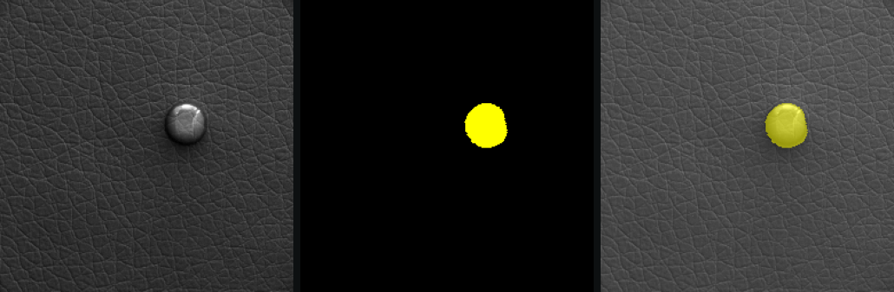
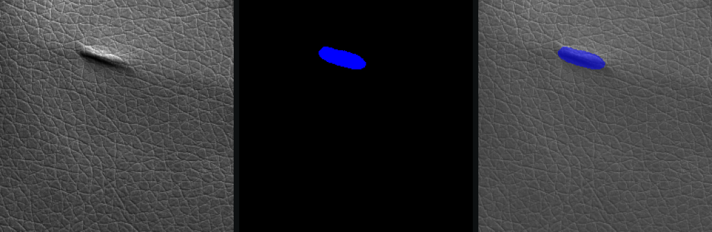
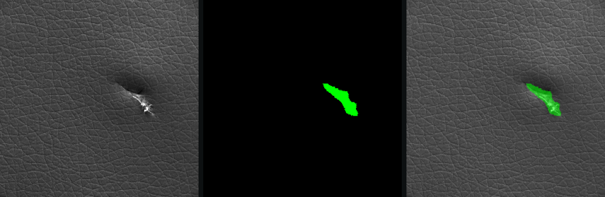
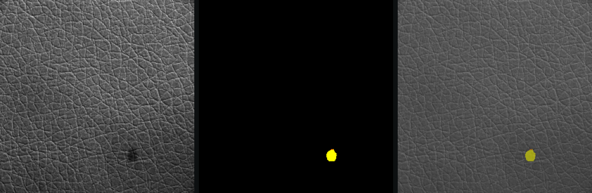

---
# ---- page header -----------------------------------------------------------
title: Leather Defect Detection
kicker: Case study · Team coursework, EE7204/EC7205 image processing & computer vision
description: >
  Pixel-level segmentation of five leather defect types with an Attention U-Net,
  run live in a PyQt5 desktop app that measures damaged area and gives a pass/fail verdict.
summary: >
  A desktop inspection tool for leather: point a camera at a hide and it colours every
  defective pixel by type (discolouration, cut, fold, glue, poke), measures the damaged
  area and gives a pass/fail verdict. Our team trained an Attention U-Net on MVTec AD with
  simulated low-light conditions. I built the application around it, running inference on a
  background thread so the window stays responsive on a machine with no GPU.
tech:
  key: [TensorFlow / Keras, Attention U-Net, PyQt5]
  other: [Python, OpenCV, NumPy, scikit-image, DDPM, Google Colab]
links:
  - text: source code
    url: https://github.com/Tharindu396/Leather_defect_detection
    primary: true

# ---- card on projects.html ---------------------------------------------------
card:
  year: 2026
  status: complete
  description: >
    Live leather inspection: an Attention U-Net labels five defect types pixel by pixel,
    and a PyQt5 app turns that into area measurements and a pass/fail verdict.
  area: ai
  tech:
    key: [TensorFlow, PyQt5]
    other: [OpenCV, U-Net]
---

## Overview

Leather is a natural material, so every hide arrives with flaws: discoloured patches, knife cuts, folds, spots of glue, small punctures. Before a hide is cut into parts, someone has to find those flaws and decide whether the piece is usable. This project automates that inspection step. It labels every pixel of a leather image as background or one of five defect types, measures how much of the surface is damaged, and compares that with a threshold to give a pass or a fail.

It was a team project for our image processing and computer vision module, and it has two halves. The offline half is a set of notebooks: a data pipeline with low-light simulation, a classical computer-vision baseline, a diffusion-model experiment for synthetic data, and the training of the segmentation network. The online half is a desktop application that runs the trained model on a webcam feed, a video file or a single image.

::: note "my role"
I designed and built the desktop application (the model wrapper, the threaded capture-and-inference worker, the interface and the snapshot export) and integrated the team's models into it. Tharindu Bandara built the classical baseline and trained the U-Nets; Akila Piumantha built the data pipeline, the low-light simulator and the diffusion model. Where this write-up says "we", it means the team.
:::

::: metrics
- **6** pixel classes: background plus five defect types
- **92** defect images with masks in the entire dataset
- **~8M** parameters in the Attention U-Net
- **0.4 s** per 640×480 frame on CPU, no GPU
:::

## The problem {#problem}

Leather inspection is still largely done by eye: an inspector examines each hide under a lamp and marks the flaws by hand. That is slow, and it depends on who is inspecting and how tired they are. Both kinds of mistake are expensive. A missed defect ends up in a finished product; an over-cautious rejection throws away good material. A yes/no classifier doesn't fix this, because grading and cutting decisions depend on *where* the damage is, *what kind* it is and *how much* of the surface it covers. That calls for segmentation: a label for every pixel.

Leather is also an awkward subject for computer vision:

- **There is no golden reference.** The grain is random and no two hides look alike, so you can't subtract a perfect template the way you would when inspecting a printed circuit board.
- **Defects look nothing like each other.** A cut is a thin dark line, a fold is a broad low-contrast ridge, glue is a glossy blob, and a colour defect is a soft-edged patch with almost no change in texture.
- **Defects are tiny.** Most cover less than 1% of the image, so a model that predicts "background" everywhere scores over 99% pixel accuracy while finding nothing.
- **Factory lighting is dim and uneven,** while the public dataset was photographed under controlled studio lighting.
- **Labelled data is scarce.** MVTec AD, the standard benchmark, has 245 defect-free leather images but only 92 defective ones with pixel masks: 17 to 19 per defect type.

::: note
MVTec AD was designed for *unsupervised* anomaly detection: train on good images only, then flag anything unusual. We used it for *supervised, multi-class* segmentation instead, which meant splitting those 92 defect images across training, validation and test. That scarcity shaped most of the decisions that follow.
:::

## Requirements {#requirements}

Before choosing techniques, we wrote down what the tool had to do for an inspector and the conditions it had to work under.

| requirement | why it matters |
| --- | --- |
| Segment five defect types separately, per pixel | Different defects lead to different decisions, and location matters for cutting |
| Report damaged area as a % of the frame, per class, and in mm² when the sample size is known | Grading depends on how much of the surface is affected |
| Give a pass/fail verdict against an adjustable threshold | Inspectors need a decision, and the acceptable level varies by product |
| Accept a webcam, a video file or a still image | Live inspection on a line, plus offline review of saved images |
| Save evidence for every inspection: frame, overlay, masks and numbers | Decisions need to be traceable and re-checkable later |
| Stay accurate in dim, uneven light | Factory lighting is nothing like the dataset's |
| Keep the interface responsive while the model runs | Inference is slower than the camera, and a frozen window is unusable |
| Run on an ordinary Windows machine with no GPU | The intended user doesn't have a machine-learning workstation |
| Load a retrained model without changing the app | The model was improved several times during the project |

## Architecture

The system has two halves that share exactly one artefact: a saved Keras model. The notebooks produce it and the app consumes it. Between them sits a small contract. A 256 × 256 image scaled to [0, 1] goes in, and a softmax over six classes comes out at the same resolution, always in the same order (`background`, `color`, `cut`, `fold`, `glue`, `poke`) and drawn with the same colours. Keeping that contract narrow let the team keep retraining while I built the app in parallel.

{pad}
*The offline notebooks and the online app meet at a single model file. The dashed boxes were experiments whose output didn't go into the shipped model.*

Inside the app, responsibilities are split across four modules, each depending only on the ones below it:

- **`main.py`** is the entry point. It works out which model to load (a command-line flag, then an environment variable, then a default location), and if none is found the app still starts, with a button to pick a model.
- **`detector.py`** wraps the model: loading, preprocessing, inference, colouring masks and computing statistics. It contains no Qt code, so the same class works from a notebook or a script.
- **`worker.py`** is a background thread that captures frames and runs the detector on them.
- **`gui.py`** is the window: controls on the left, the live view in the middle, statistics and the verdict on the right.

::: decision
- **context:** Inference takes about 0.4 s per frame on a CPU, while a webcam delivers a new frame every 33 ms. Running the model on the UI thread would freeze the window between frames.
- **decision:** A dedicated `QThread` does capture and inference and hands each result to the UI thread through Qt's queued signals; the UI thread only draws. The camera buffer is limited to one frame, so the worker always takes the newest frame instead of working through a backlog.
- **trade-off:** The window stays responsive and the view never lags behind reality, but on a slow machine most webcam frames are never inspected. For live inspection that is the right call. Video files are the exception: every frame is processed, slower than real time.
:::

::: decision "decision · what the worker sends"
- **context:** During inspection, people constantly toggle defect classes on and off and drag the overlay-opacity slider.
- **decision:** The worker emits the raw integer class mask rather than a rendered image, and the UI colours it on demand.
- **trade-off:** Display changes are instant and never re-run the model. Statistics come from the unfiltered mask, so hiding a class can never change the verdict. The cost is a palette lookup on the UI thread for every redraw, which is negligible.
:::

## How it was solved {#solution}

::: flow
1. **Data** MVTec AD, augmentation and low-light simulation
2. **Baseline** classical computer vision, to set the bar
3. **Synthetic data** a diffusion-model experiment
4. **Attention U-Net** the model the app runs {key}
5. **Desktop app** live inspection without a GPU
:::
*The five strands of the project, from raw data to a tool an inspector can use.*

### 1. Data, and a realistic kind of dark

Every image was resized to 256 × 256, using Lanczos resampling for photos and nearest-neighbour for masks so the labels stay crisp. The defect images were split into training, validation and test sets stratified by defect type, so every class appears in each set. MVTec stores one binary mask per defect image and files the images in folders named after the defect type. A multi-class label map is therefore just the binary mask multiplied by the class index of its folder.

Augmentation had to respect the labels. Geometric changes (flips, 90° rotations, scaling) are applied identically to the image and its mask, while photometric ones (brightness, contrast, hue and saturation jitter, blur, noise) touch only the image. Leather has no natural "up", so rotations are free extra data. For v3, defect images were also oversampled, appearing three times per epoch (four for pokes) against once for defect-free images.

To make the model robust to bad lighting, Akila wrote a low-light simulator that degrades a well-lit image in four steps, each mimicking a real cause:

| step | what it simulates |
| --- | --- |
| gamma darkening | an under-lit scene |
| directional brightness gradient | a light source off to one side |
| vignetting | a cheap lens that darkens towards the edges |
| Gaussian noise | sensor noise at high gain |

Each defect image gets several degraded copies that share its mask (three for training images, two for validation, one for test). PSNR and SSIM quantify how far the copies drift from the originals. Getting the strength right took several rounds. The first setting, with gamma up to 4, produced images so dark and noisy that there was little left to learn from. The final range is much milder: closer to a dim factory floor than a dark room.

### 2. A classical baseline to beat

Alongside the first deep-learning attempts, Tharindu built a pure computer-vision pipeline to find out how far hand-crafted features could go. It models "good leather" from 50 defect-free images, as the per-pixel mean and standard deviation in greyscale and in LAB colour space, then scores each test image with five anomaly maps:

- the multi-scale difference from that reference, measured in standard deviations
- colour distance in LAB space
- texture energy from a bank of 40 Gabor filters (5 frequencies × 8 orientations)
- Laplacian-of-Gaussian edge response, aimed at cuts and folds
- local variance, to catch changes in texture

The maps are blended with per-defect-type weights, thresholded, and cleaned up with morphological closing and opening and by discarding small connected components. The saved run covers three of the five classes:

| defect | IoU | Dice | precision | recall |
| --- | --- | --- | --- | --- |
| colour | 0.0059 | 0.0112 | 0.0060 | 0.1024 |
| cut | 0.0835 | 0.1482 | 0.0853 | 0.8932 |
| fold | 0.1285 | 0.2221 | 0.1632 | 0.5126 |

The pattern of high recall and very low precision says more than the averages do:

- **The threshold decides the answer in advance.** A percentile threshold marks at least the top 3–5% of pixels as defective in every image. Most defects are far smaller than that, so precision stays low however good the anomaly maps are.
- **An average hide is a blur.** Because the grain is random, the per-pixel mean of 50 good images is a smooth grey sheet. Every test image differs from it everywhere, not just at the defect.
- **It needs the answer to find the answer.** Weights, kernel sizes and thresholds are tuned per defect type, so you would have to know which defect is present before looking for it. That can't be deployed.
- **Colour defects are almost invisible to it.** A soft shift in hue has no edge and no texture change for the filters to catch.

::: decision "decision · learned features"
- **context:** The best classical result was an IoU of 0.13, and only with settings tuned for each defect type.
- **decision:** Commit to supervised semantic segmentation: one network that learns its own features and labels all five classes at once.
- **trade-off:** No per-type tuning, and the network can learn which texture to ignore. In exchange, it needs pixel-level labels (only 92 images have them), GPU time to train, and it is much harder to explain than five anomaly maps.
:::

### 3. Synthetic data with a diffusion model

With so few defect images, generating more was an obvious idea. Akila implemented a denoising diffusion probabilistic model (DDPM) from scratch in TensorFlow. It uses a linear noise schedule over 1,000 steps, a U-Net noise predictor with sinusoidal timestep embeddings, residual blocks and self-attention at the bottleneck, and a moving average of the weights for sampling. Generated images were compared with real ones using PSNR and SSIM, and with each other, to catch a model that produces the same image every time.

The first version, trained at 64 × 64 on the dark low-light copies alone, had too little signal to learn what leather looks like. The second trained at the full 256 × 256 on every leather image (good and defective, normal and low-light) and switched to DDIM sampling, which can skip steps correctly and needs 200 denoising steps instead of 1,000.

The bigger lesson was about labels. An unconditional diffusion model generates images, not image–mask pairs, so the samples were saved with empty placeholder masks. They can't teach a segmentation network where a defect is. Worse, mixed naively into the training set, a defective-looking image with an empty mask would teach the network that defects are background. The segmentation models were trained only on real images and their low-light copies.

### 4. The Attention U-Net

Our first plain U-Net reached a validation mean IoU of only 0.167 before early stopping ended its training at epoch 21. Tharindu's redesign kept the U-Net shape and added components aimed at the specific ways it was failing.

{pad}
*Every block uses squeeze-and-excitation (SE), every skip connection passes through an attention gate (AG), and v3 adds an auxiliary output for deep supervision.*

- **Encoder–decoder with skip connections.** The encoder halves the resolution four times (32 to 512 filters) to understand context. The decoder rebuilds full resolution, and skip connections carry fine detail across so that thin cuts and small pokes survive.
- **Attention gates on every skip connection.** The decoder's coarser, more semantic features decide which encoder features get through. This answers the classical baseline's core problem: grain looks "anomalous" everywhere, and the gates learn to suppress it while letting defect edges through.
- **Squeeze-and-excitation in every block.** Each block re-weights its channels using a summary of the whole image, amplifying the features that matter for the image at hand.
- **Spatial dropout that grows with depth,** from 5% of feature maps near the input to 30% at the bottleneck, so an 8-million-parameter network can't simply memorise a few dozen training images.

Class imbalance is handled in the loss. Focal loss down-weights the easy background pixels the network already gets right. Dice loss is averaged over the five defect classes only, so background can't dominate it. Training used a short learning-rate warm-up followed by cosine decay.

The model went through two generations:

| | v1 | v3 |
| --- | --- | --- |
| input | 256 × 256 greyscale | 256 × 256 RGB, contrast-enhanced with CLAHE |
| training data | the 92 MVTec defect images, 80/20 train/validation split | MVTec images plus their low-light copies, with oversampling |
| outputs | one segmentation map | main map, plus an auxiliary map from the 64 × 64 decoder stage |
| loss | 0.5 × focal + 0.5 × Dice | 0.3 × focal + 0.7 × Dice, both weighted by class frequency; auxiliary output weighted 0.4 |
| schedule | 30 epochs | up to 50 epochs on a Colab GPU, early stopping on validation IoU |
| parameters | 7.97 M | 7.97 M |

v3's changes target what v1 got wrong. RGB input gives the network the colour information it needs for colour defects. CLAHE (contrast-limited adaptive histogram equalisation) recovers local contrast in dark regions before the image reaches the network. The auxiliary output gives the middle of the decoder its own training signal, which helps a deep network learn from very little data.

### 5. The desktop app

This was my part. Its job is to turn a segmentation map into something an inspector can act on, live, on hardware they already have.

::: flow
1. **Capture** a webcam, video or image frame via OpenCV
2. **Preprocess** greyscale, 256 × 256, scaled to [0, 1]
3. **Infer** the Attention U-Net's softmax over six classes {key}
4. **Post-process** argmax, then nearest-neighbour upscaling to the frame size
5. **Report** overlay, area per class, pass or fail
:::
*What happens to every frame. Steps 1–4 run on the worker thread; step 5 runs on the UI thread.*

{pad}
*The window layout: controls on the left, the live view in the centre, the verdict and statistics on the right.*

<!-- TODO: add a real screenshot of the app running in overlay mode, next to or instead of the wireframe. -->

What the inspector gets:

- **Four display modes:** overlay, mask only, side by side, and the original image, with an opacity slider and a checkbox per defect class.
- **Area and verdict:** total and per-class defect area as a percentage and in pixels. Enter the sample's width and height in millimetres and it also reports mm². The verdict badge turns red when total defect area crosses the threshold, which is 1% by default.
- **Snapshots:** one click writes five files sharing a timestamp: the original frame, the overlay, the colour mask, the raw integer mask for later analysis, and a JSON file with the statistics, threshold, verdict and which classes were visible.

A few small details mattered more than expected:

- **Nearest-neighbour upscaling.** The mask is predicted at 256 × 256 and stretched to the camera's resolution. Smooth interpolation would invent classes along boundaries: halfway between colour (1) and fold (3) is 2, which is cut. Nearest-neighbour keeps every pixel a real label.
- **A warm-up prediction at load time.** TensorFlow builds its graph on the first call, so the app runs one dummy prediction while loading instead of stalling on the first real frame.
- **Calling the model directly** rather than through `model.predict`, which is designed for batches and adds overhead to single-frame inference.
- **Reading the input shape from the model.** The detector checks how many channels the loaded model expects and shapes frames to match.

Two problems had nothing to do with machine learning:

::: note "windows dll clash"
On Windows, TensorFlow failed to start inside the app with `DllMain returned FALSE` (error 0x45A). PyQt5 and OpenCV each ship their own copy of the Microsoft C++ runtime, and if either loads first, TensorFlow's native code can't initialise. The fix is import order: TensorFlow is loaded before any GUI or OpenCV module, so all three share the system runtime. Both the entry point and the GUI module enforce it, with comments warning anyone not to reorder those imports.
:::

- **Model files from a newer Keras.** The models were saved by a newer Keras that writes an extra `quantization_config` setting into every dense layer, which older installations reject. Rather than pin everyone to one exact version, the detector patches the dense layer's constructor to ignore that argument while the model loads, and always restores it afterwards.

## Results

The project delivered a working inspection tool. It segments five defect types live from a webcam, a video or a still image, measures defect area, and gives a pass/fail verdict, at about 0.4 s per 640 × 480 frame on a CPU with no GPU.

The examples below are v1 predictions from the team's area-calculator notebook, which ran the model over all 92 defect images in MVTec AD. Across them, the model flagged 0.86% of pixels as defective. Folds were the largest defects at 2.6% of the frame on average, colour defects the smallest at 0.25%. Some of these images were in v1's training set, so read them as examples of what the masks look like, not as a measure of how well the model generalises.

<!-- TODO: add held-out test IoU / Dice per class for v1 and v3, ideally split into normal vs low-light. The v3 notebook's evaluate_model() prints both, but the outputs aren't saved in the repo. A ::: metrics block or a table row next to the classical baseline would fit here. -->

::: gallery

*Glue: original, predicted mask, overlay. The mask follows the blob's outline.*

*Fold: broad and low-contrast, the kind of defect the classical edge filters struggled with.*

*Cut: the mask covers the tear and its frayed edge.*

*A failure: a dark colour spot labelled as glue. In greyscale, which is all v1 sees, a dark round spot looks like a glue blob. v3 switched to RGB input to give the network colour information.*
:::

*Leather images from [MVTec AD](https://www.mvtec.com/company/research/datasets/mvtec-ad), CC BY-NC-SA 4.0.*

## What I learned {#lessons}

- **A baseline that fails is worth building.** The classical pipeline's numbers didn't just say "worse". The high-recall, low-precision pattern pointed straight at the fixed threshold and the per-type tuning, and it explained why the network needed attention gates to ignore the grain.
- **Generate labels, not just images.** An unconditional diffusion model gave us leather without masks. Next time I'd generate image–mask pairs, for example by conditioning the diffusion model on a mask, or by pasting real defects onto clean leather.
- **Write down the contract between training and deployment.** v3 changed three things at once: RGB instead of greyscale, CLAHE preprocessing, and a second output. The app's adapter only handled the channel count. I'd now ship the preprocessing steps and output layout alongside the model file, and test the app against every new model before it's handed over.
- **Most deployment bugs aren't machine-learning bugs.** The hardest problems in the app were DLL load order, serialisation differences between library versions, and frame latency. None of them appear in a tutorial, and each one alone stops a good model from being useful.
- **Measure robustness directly.** We trained on low-light copies, but what matters is the score on low-light test images compared with normal ones. The v3 notebook computes that split; publishing it next to the model is the next step.
