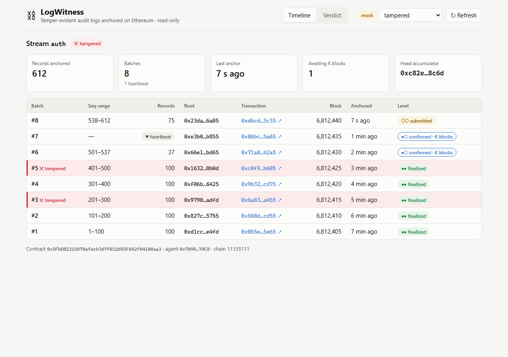
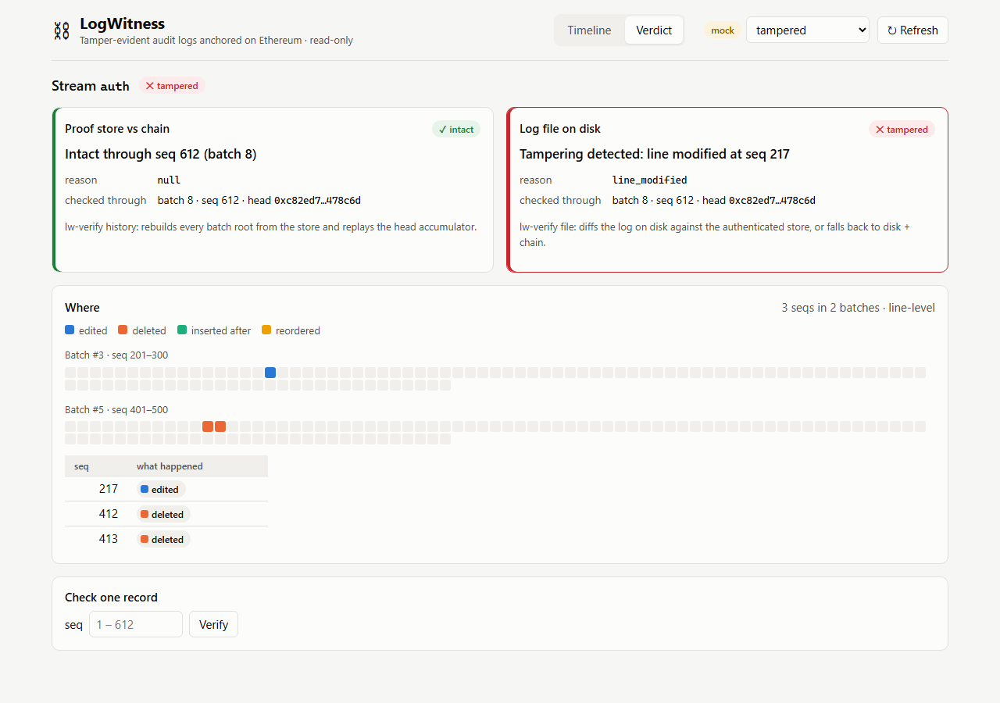

---
# ============================================================================
# PROJECT CASE STUDY · LogWitness
# Edit the case study here, then ask Claude to
# "generate projects/log-witness/index.html from _case-study.md".
# The guide to the extra blocks is in projects/_template/_case-study.md.
# ============================================================================

# ---- page header -----------------------------------------------------------
title: LogWitness
kicker: Case study · EC8204 Blockchain and Cyber Security, University of Ruhuna
description: >
  Tamper-evident audit logs that use a public Ethereum contract as an outside witness,
  so an edited, deleted, inserted or reordered log line can be proven and located.
summary: >
  An attacker with root on a server can rewrite its logs to hide what they did, and every
  check that lives on that server falls with it. LogWitness hashes log lines into Merkle trees
  and commits only each tree's 32-byte root to a public Ethereum contract that nobody
  administers. A verifier on another machine can later prove whether any anchored line was
  edited, deleted, inserted or reordered, and point to the exact line.
tech:
  key: [Ethereum, Solidity, Go]
  other: [Foundry, OpenZeppelin, SQLite, React, TypeScript, Docker]
links:
  - text: source code
    url: https://github.com/Malee-Fonseka/log-witness
    primary: true

# ---- card on projects.html ---------------------------------------------------
card:
  year: 2026
  status: in progress
  description: >
    Tamper-evident audit logs anchored on Ethereum. Only Merkle roots go on-chain,
    and a verifier can name the exact line an attacker changed.
  area: software systems      # ai | data engineering | software systems | research | other
  tech:
    key: [Blockchain, Solidity, Go]   # Blockchain shows on the card that one is used
    other: [Ethereum, Foundry]
---

<!--
  Sources: docs/Architecture.md, docs/spec/, docs/adr/, attacks/README.md and
  bench/results/*.csv (figures as of 29 Sep 2026). Screenshots are the dashboard on
  fixture data; regenerate from the live stack once lw-verify serve lands.
-->

## Overview

LogWitness is a tamper-evidence system for server logs, built by a team of four for the Blockchain and Cyber Security module at the University of Ruhuna. A small agent on each server follows a log file, groups new lines into batches and hashes each batch into a Merkle tree. Only the tree's root, a 32-byte fingerprint, and the range of line numbers it covers are sent to a smart contract on Ethereum. The log itself never leaves the organisation.

Once a root is on the chain, nobody can change it, including someone with full control of the server. A verifier running on a separate machine can then rebuild the fingerprints from whatever logs remain and compare. If anything was edited, removed, added or shuffled after anchoring, the verifier says so and names the line.

::: metrics
- **32 B** committed on-chain per batch, whatever its size
- **39.6k** gas per anchor, flat from 1 to 100,000 lines
- **53%** less gas than storing each batch in contract storage
- **4** kinds of tampering located to the exact line
:::

## The problem {#problem}

Logs are how incident responders reconstruct what happened, which makes them the first thing a capable attacker cleans up. Clearing or editing logs is a standard technique, catalogued in MITRE ATT&CK as T1070, *Indicator Removal*. An attacker with root can open the authentication log, delete the line that shows their login, and leave nothing behind that looks wrong.

The usual defences share one weakness: they live on a machine the attacker can reach, or they are run by someone who can rewrite them.

- **File permissions and append-only flags** are enforced by the operating system the attacker now controls.
- **A local hash chain or signed log** keeps its key or its latest hash on the same machine. Root can read the key, rewrite the history and recompute every hash.
- **A central log server** moves the problem to another administrator. An attacker who reaches that server, or an insider who runs it, can rewrite it the same way.
- **A permissioned blockchain** has a small set of operators who can agree to rewrite it, which brings back the trusted administrator the design is trying to remove.
- **Writing the logs themselves to a public chain** would make them unchangeable, but it costs gas for every line and publishes private data to the world.

What was missing was an outside witness: something the attacker cannot log into, which holds just enough to check the logs later without holding the logs. We set these requirements:

- Detect **modification, deletion, insertion and reordering** of any line anchored before the compromise.
- **Localise** tampering to a specific line, or at worst to a specific batch.
- Keep the on-chain cost **constant per batch**, however many lines it covers.
- Keep log content **private**. Only hashes leave the organisation.
- Treat the server, its disk, its database and its clock as hostile once compromised. **The chain is the only thing we trust.**

::: note "scope"
LogWitness detects tampering; it does not prevent it, and it does not restore what was deleted. It cannot vouch for an application that writes false lines either, because integrity starts when a line is written. Lines written after the last anchor and before the attack are unprotected, and that window is bounded by the batch interval, 60 seconds by default.
:::

## Architecture

The system is split across three trust zones, and that split drives every other decision.

{pad}
*Solid arrows are the write path; dashed arrows are what the verifier reads. Only the contract in the middle is trusted. The proof store and the log file are both checked against it before anything they say is believed.*

- **The monitored host** runs the application, its log file, the LogWitness agent and a local proof store, a SQLite database holding copies of the lines and the batch history. Everything here is assumed hostile after a compromise. The proof store is relied on for availability, never for integrity: it makes verification faster and more precise, but nothing in it is believed until it has been checked against the chain.
- **Ethereum** runs one small contract, AuditAnchor. For each log stream it keeps a compact head (which key may write, the next batch number, the last line number, the time of the last anchor and a running hash of every batch so far) and records each batch in an event. It has no proxy, no upgrade function and no administrator who can edit history.
- **The analyst's machine** runs the verifier and a read-only dashboard, outside the attacker's reach. All verification logic lives in the verifier; the dashboard only displays its verdicts.

The agent is a single process that owns the whole pipeline, from following the file to submitting the anchor. That gives one key holder, no queue between processes for data to get lost in, and one state machine to reason about after a crash.

::: decision
- **context:** Logs are private and high-volume, and every byte stored on Ethereum costs gas.
- **decision:** Put only Merkle roots and line-number ranges on-chain. Keep the lines themselves in the organisation's own storage.
- **trade-off:** On-chain cost is constant per batch and no content is exposed. In exchange, verification depends on off-chain data being available, so making that data untrusted but still useful became our problem rather than the chain's.
:::

::: decision
- **context:** A permissioned ledger or an upgradeable contract would have been easier to operate and to fix.
- **decision:** Use a public, permissionless chain (a local Anvil node for development, the Sepolia testnet for the demo) and a contract that can never be upgraded.
- **trade-off:** Nobody, including us, can change the rules or the history after the fact. Bugs cannot be patched in place: a fix is a new deployment, and old anchors stay verifiable at the old address. We offset that with full test coverage, invariant fuzzing and static analysis on every change.
:::

## How it works {#how-it-works}

::: flow
1. **Tail** follow the log file, across rotations
2. **Batch** close at 1,000 lines or 60 seconds
3. **Hash** build an RFC 6962 Merkle tree
4. **Persist** lines, batch and read position in one transaction
5. **Anchor** the contract checks continuity and records the root {key}
:::
*Every line passes through the same five steps inside the agent. Only the last one touches the chain.*

### Turning a line into a fingerprint

Each line is wrapped in a fixed, versioned record before it is hashed: an encoding version, the stream it belongs to, its sequence number, its length and its raw bytes. Nothing is trimmed or normalised, and long lines are never truncated, because the verifier must be able to reproduce exactly the same bytes from the file on disk.

The sequence number is what makes deletion visible. Hashing content alone can show that a line changed, but not that one is missing. Numbering every line from 1 with no gaps, and binding that number into the hash, turns a deleted line into a hole that cannot be hidden.

What the record leaves out matters just as much: it has **no timestamp**. The agent's clock is under the attacker's control after a compromise, and the time a line was read is stored nowhere except the local database. If it were part of the hash, losing that database would make the log file impossible to verify. Order comes from the sequence number, trusted time comes from the block the anchor lands in, and the event's own time is already inside the log line.

{pad}
*One batch of five lines becomes one root. The unpaired fifth line is promoted rather than duplicated. Every anchored batch is then folded into a single head hash that the contract computes itself.*

### Merkle trees, done by the standard

Batches are hashed into Merkle trees exactly as RFC 6962 (Certificate Transparency) specifies, because the details are where tree designs go wrong:

- **Leaves and internal nodes are hashed with different prefixes.** Without that, an attacker can pass off an internal node as a leaf, a second-preimage attack.
- **Unbalanced trees are split at the largest power of two**, and an unpaired node is promoted, never duplicated. Duplicating the last node is the root cause of Bitcoin's CVE-2012-2459.
- **Inclusion proofs carry the tree size.** In an unbalanced tree, a leaf's position alone does not say which levels have a sibling.

The tree exists twice: in Go for the agent and verifier, and in Solidity for optional on-chain checks. Two implementations of one algorithm drift apart quietly, and here drift would surface as a false tamper alarm. So the format is specified in prose first, and both implementations must pass the same known-answer test vectors. Those vectors are generated from an independent reference library, never from our own code, so the tests cannot simply agree with themselves.

### The contract as witness

The contract refuses to record a batch that would break the history. An anchor is rejected unless all four rules hold:

| rule | what it guarantees | what it stops |
| --- | --- | --- |
| the sender is the stream's registered agent | only that host's key writes to that stream | foreign or revoked writers |
| the batch number is exactly the next one | batches land in order, once each | gaps, replays, duplicate submissions after a crash |
| the batch starts right after the last anchored line | line ranges join up with no overlap | sequence gaps or overlaps between batches |
| the line range and line count agree | the range is honest, and empty batches are valid | ranges that claim more or fewer lines than they hold |

Because the ledger enforces these rules, a buggy or compromised agent cannot produce a history that merely looks continuous. The chain refuses to record the discontinuity.

On top of that, the contract keeps a **head hash**. Each anchor folds the previous head together with the new batch's number, root, line range and count. The contract computes this itself, so the agent never supplies a value it could get wrong. It also lets the verifier catch a dishonest blockchain node: replay every anchored batch from the event log, recompute the head, and compare it with the single value the contract returns. A node that hides or swaps a batch cannot make those two match.

Authority is per stream, so a key stolen from one server cannot write to another server's log. A registrar can register streams and rotate or revoke an agent's key, but cannot touch anything already anchored. Batch details live in events rather than contract storage, which keeps storage to the small per-stream head and roughly halves the gas cost of every anchor.

### Making silence detectable

A batch closes when it reaches 1,000 lines or when 60 seconds pass, whichever comes first. If 60 seconds pass with no new lines, the agent anchors an **empty heartbeat batch** anyway. The chain therefore always holds a recent anchor, and if none arrives within three intervals the verifier raises a missing-heartbeat alarm. An attacker who kills the agent to stop the anchoring creates exactly the evidence they wanted to avoid.

### Surviving crashes and chain reorganisations

The agent has to stay correct through crashes, restarts and blocks that get reorganised away, without leaving gaps or anchoring anything twice.

- When a batch closes, its lines, its batch record and the file read position are written in **one database transaction**. A crash either loses the whole unsaved batch, which is re-read from the old position and given the same sequence numbers, or keeps all of it. There is no state in between.
- At most **one anchor transaction is in flight** per stream; later batches wait their turn.
- **The chain wins on restart.** The agent reads the contract's head, marks everything already anchored as done, and resubmits the rest in order. Because the batch number must be exactly the next one, a duplicate submission is rejected harmlessly instead of being recorded twice.
- An anchor counts as **confirmed** once it is three blocks deep, which the live demo uses, and **finalised** once the chain finalises it, which is what evidence relies on.

### Verifying in two stages

Verification runs away from the host and believes nothing it reads there until the chain vouches for it.

1. **Authenticate the proof store.** Rebuild every batch root from the stored lines and compare it with the anchored root, then recompute the head hash and compare it with the contract's. If everything matches, the store is a faithful copy of what was anchored.
2. **Compare the log file with the authenticated store.** Each mismatch is classified as an edit, deletion, insertion or reordering and reported with its exact sequence number.

If the store is missing or fails the first stage, the verifier falls back to **the log file and the chain alone**. It reads the file in order, takes as many lines as each batch says it holds, and rebuilds each root. That can only localise tampering to the first failing batch rather than a single line, but it still works, and it works only because the timestamp was kept out of the hash. The local database is useful, but the system never depends on it for integrity.

Every attack in the threat model is also an automated end-to-end test with an expected verdict:

| attack | what the verifier reports |
| --- | --- |
| none (control) | intact |
| edit one line | tampered · line modified · that line |
| delete one line | tampered · line deleted · that line |
| insert a forged line | tampered · line inserted · its position |
| swap two lines | tampered · lines reordered · both lines |
| truncate the file | tampered · every missing line |
| edit the local database | tampered · store fails authentication · log file still shown intact |
| kill the agent | tampered · missing heartbeat |
| roll the clock back | intact: time is not in the hash, so there is no false alarm |

## Results

Every number here comes from a benchmark script in the repository rather than being typed by hand.

::: metrics
- **39,645** gas per anchor, batch data in events
- **84,380** gas per anchor, batch data in storage
- **$0.13** per anchor on Ethereum mainnet
- **50k** lines per second ingested without falling behind
:::

- **Constant cost.** Gas per anchor barely moves with batch size: 39,261 for a one-line batch and 39,297 for a 100,000-line batch. An empty heartbeat costs 39,621.
- **Events beat storage.** Keeping batch details in events instead of contract storage cut a routine anchor from 84,380 to 39,645 gas, 53% less. Moving the rarely changing agent address into its own storage slot means each anchor writes two slots instead of three, which saved a further 7% along the way.
- **Cost follows time, not volume.** At fees observed on 29 September 2026, one anchor costs about $0.13 on mainnet. With a batch at least every 60 seconds that is 1,440 anchors and roughly $190 a day per stream, whether the server writes ten lines or ten million. A ten-minute interval would bring that to about $19, at the price of a ten times wider unprotected window. That interval is the real dial between cost and exposure.
- **Hashing is not the bottleneck.** A 1,000-line tree builds in about 0.13 ms, roughly 7.5 million lines per second. A proof that one line belongs to a 1,000-line batch is 10 hashes, 320 bytes.
- **The agent keeps up** with 50,000 lines per second in a five-second burst and falls behind at 100,000.
- **Checking a proof on-chain** is optional and costs about 31,600 gas for a 1,024-line batch, adding roughly 2,000 gas each time the batch size doubles.
- **Contract quality.** 100% line, statement, branch and function coverage; the four continuity rules hold under randomised invariant fuzzing; Slither static analysis reports no findings.

::: gallery

*Timeline: every anchored batch with its line range, root, transaction and confirmation level. Two batches are flagged as tampered and one is a heartbeat.*

*Verdict: the proof store checks out against the chain, while the log file on disk has one edited and two deleted lines, each named by sequence number.*
:::

::: note "status"
The contract, the record and Merkle libraries, the agent pipeline and the benchmarks are complete. The verifier's end-to-end commands, the Sepolia deployment and the full attack run are still being finished, so the attack table above is the acceptance target rather than a measured result, and the screenshots show the dashboard on fixture data.
:::

## What I learned {#lessons}

<!-- Written from the team's point of view. Add your own role (which of M1–M4 you were
     and what you owned) and adjust these to match what you personally took away. -->

- **Decide what you trust before designing anything.** Writing down early that the host, its database and its clock are all hostile after a compromise settled most later arguments: the database became disposable, time left the hash, and the chain became the only judge.
- **Push invariants to the party that cannot be compromised.** Because the contract enforces continuity and computes the head hash itself, a buggy agent fails loudly instead of quietly writing a history that looks fine.
- **What you leave out of a hash matters as much as what you put in.** Dropping a single timestamp field is what lets a log be verified after its database is gone.
- **Two implementations need an independent referee.** With test vectors from a reference library, the Go and Solidity trees are checked against the same answers, so a disagreement shows up in the build rather than as a false alarm in front of an analyst.
- **Freeze the interfaces first.** Agreeing the record format, the contract interface and the database schema at the start let four people build in parallel without waiting on one another.
- **Detection is not recovery.** LogWitness can prove that a line is gone and say where, but not bring it back. A real deployment would pair it with off-host replication of the logs and the proof store, which we left as future work.
