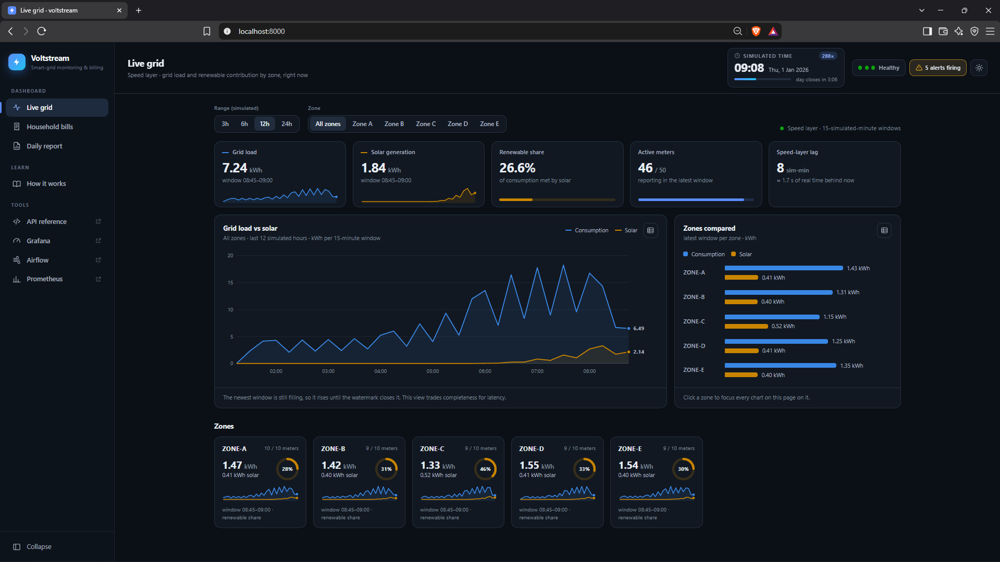
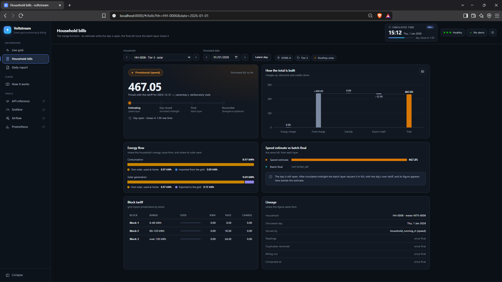
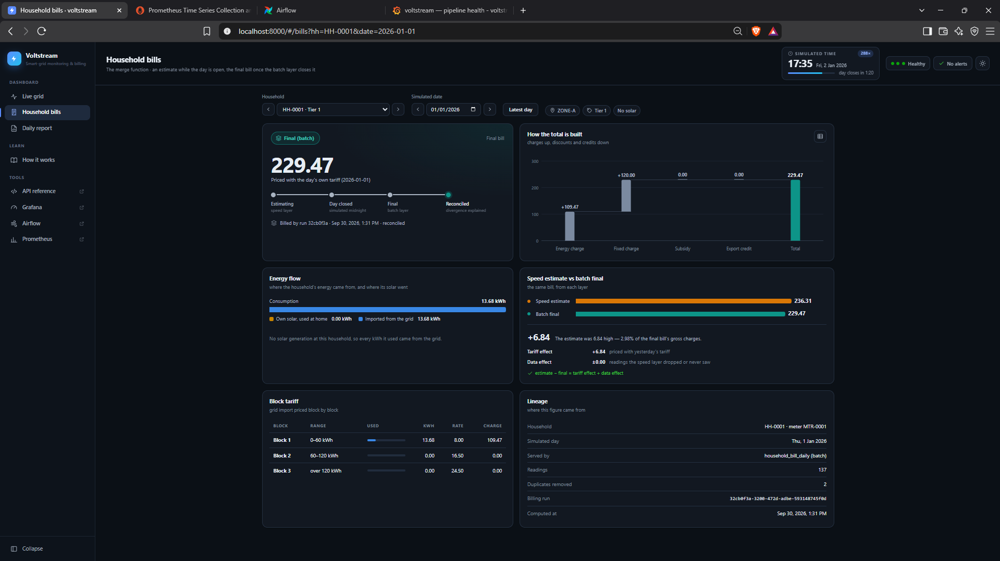

---
# ============================================================================
# PROJECT CASE STUDY: VOLTSTREAM
# ============================================================================
# Edit the case study here, then ask Claude to
# "generate projects/voltstream/index.html from _case-study.md".
# The guide to the extra blocks is in projects/_template/_case-study.md.
# ============================================================================

# ---- page header -----------------------------------------------------------
title: Voltstream
kicker: Case study · Big Data Analytics, University of Ruhuna · team project
description: >
  A Lambda-architecture data platform that turns one stream of smart-meter readings
  into a live grid dashboard and exact, auditable daily household bills.
summary: >
  Voltstream takes one stream of smart-meter readings and serves two users who want
  opposite things: grid operators, who need load and solar share by zone within seconds,
  and billing, which needs an exact bill for every household that can be recalculated
  months later. It uses a Lambda architecture built on Kafka, Spark, Airflow and
  PostgreSQL, and both layers share one tested billing module, so when their numbers
  differ the cause is always the data they saw, never the code.
tech:
  key: [Apache Kafka, Apache Spark, Apache Airflow]
  other: [Python, PostgreSQL, Parquet, S3-compatible object storage, FastAPI, Prometheus, Grafana, Docker Compose]
links:
  - text: source code
    url: https://github.com/Malee-Fonseka/voltstream
    primary: true

# ---- card on projects.html ---------------------------------------------------
card:
  year: 2026
  status: complete
  description: >
    A streaming and batch data platform for a simulated smart grid: live zone monitoring
    about 6 seconds behind the meters, and exact daily bills that can be re-run from the
    raw data at any time.
  area: data engineering      # ai | data engineering | software systems | research | other
  tech:
    key: [Kafka, Spark, Airflow]
    other: [PostgreSQL, FastAPI, Grafana]
---

## Overview

Voltstream is the data platform my team of three built for the *Smart Grid Energy
Monitoring and Billing* use case in our Big Data Analytics module. Fifty simulated
households send electricity use and rooftop-solar readings every two seconds, and a tariff
file arrives once per simulated day. From that, the platform produces a live view of grid
load and renewable share for each of five zones, a final bill for every household for every
day, a daily report, and alerts when something goes wrong in the grid or in the pipeline
itself.

The same readings serve two users with conflicting needs, and that conflict decided the
architecture. The whole system, eighteen containers, starts with one command on a laptop,
and every number on this page was measured on that running system.

::: metrics
- **6.3 s** mean delay from a meter reading to the live dashboard (target: under 60 s)
- **59 s** to bill a complete day for all 50 households
- **0** readings lost when either streaming job was killed mid-run
- **1.9%** mean gap between the live estimate and the final bill, about 90% of it explained by the tariff
:::

::: note "my role"
We split the work by pipeline stage, and each of us owned a stage end to end. I set up the
project and task plan, drafted the architecture and kept the decision log (the Lambda versus
Kappa call was agreed by the whole group), and built the reconciliation between the two
layers, the observability stack, the fault-injection, demo and re-billing scripts, the
dashboard, and the CI and reproducibility set-up. I also wrote the README and runbook and
led the review and debugging pass before submission.
:::

*The Live grid tab, fed by the speed layer and refreshed every 5 seconds. The clock in the
corner is simulated time, which runs 288 times faster than real time.*

## The problem {#problem}

A power grid has to balance supply and demand at every moment. Rooftop solar makes that
harder because the utility cannot control it: when a cloud passes over a zone, solar output
can fall within a minute, and slower power stations have to make up the difference.
Operators therefore need each zone's load and renewable contribution *right now*, and the
information is only useful if it arrives quickly.

The billing department works from the same readings but needs something else. A bill
combines block tariffs (the price per kWh rises as usage crosses thresholds), a fixed charge
that depends on the household's tier, a subsidy discount, and a credit for solar energy
exported to the grid. It is also priced with *that day's* tariff, which is not published
until the day has ended.

The brief posed one question in two halves: what is the grid load and renewable
contribution in each zone right now, and what will each household's bill be once the daily
tariff is applied? Side by side, the two halves pull in opposite directions.

| | Grid operations | Billing |
| --- | --- | --- |
| Question | Load and renewable mix by zone | A household's bill for the day |
| How fast | Seconds | After the day closes |
| A 2% error | Harmless; operators would act the same way | Legally actionable |
| Late readings | Can be ignored | Must be included |
| Recalculating a past day | Never | Months later, when a bill is disputed |
| Audit trail | Not needed | Every bill traceable to its readings |

::: note
"Once the daily tariff is applied" means the final bill depends on data that does not exist
until the day is over. That is a business rule, not a technical limit, so no streaming
technique can remove it. Whatever the design, it has to show an estimate during the day and
replace it with the real bill afterwards.
:::

## Requirements {#requirements}

We turned the brief into five functional requirements:

1. Ingest a continuous stream of meter readings, plus one tariff file and one weather file
   per simulated day.
2. Keep every raw reading permanently and unchanged, so any result can be recalculated.
3. Calculate each zone's load and renewable contribution over short time windows.
4. Compute a daily bill for each household, with solar netting, block tariffs, fixed
   charges, subsidy and export credit.
5. Provide a live dashboard, a daily report, and alerts when values cross a threshold.

We also set six non-functional requirements, each with a number we could test against:

| ID | Requirement | Why |
| --- | --- | --- |
| N1 | Live view less than 60 s behind the meters | Operators must be able to react within a minute |
| N2 | Each closed day billed within 10 real minutes | It has to fit into a live demonstration |
| N3 | No data lost when any single component fails | Readings are money |
| N4 | Any past day can be re-billed at any time | Disputes arrive long after the data |
| N5 | Runs from a clean clone with one command | The markers had to be able to reproduce every result |
| N6 | Every stage of the pipeline observable | A failure nobody can see is the worst kind |

::: note "a faster clock"
Watching a real day go by takes 24 hours, so the system runs on a simulated clock: one
simulated day passes in five real minutes, 288 times faster than real time. Each meter sends
a reading every two real seconds, which works out to 150 readings per meter per simulated
day, about 7,500 in total. All grouping and billing uses simulated time, and only latency is
measured on the real clock. A single module converts between the two clocks, and every
duration in the configuration says which clock it belongs to, because mixing them up is an
easy way to break a streaming job. The faster clock had one effect we did not predict,
covered in the results.
:::

## Architecture

### Lambda or Kappa?

There are two standard shapes for a system like this. **Lambda** processes the same data
along two paths: a *speed layer* computes approximate results from recent data as it
arrives, a *batch layer* periodically recomputes exact results from all the stored data, and
a serving layer combines the two. **Kappa** uses a single streaming path and fixes mistakes
by replaying old data from the message log through the same code.

We compared them on the four criteria the brief named:

| Criterion | What we found | Favours |
| --- | --- | --- |
| Latency | Operations need seconds and billing needs hours. A single path can be tuned for only one of them: if it waits for late data the live view lags, and if it doesn't the bills are wrong. | Lambda |
| Replay | Disputes and tariff corrections can arrive months later, but Kafka keeps messages for days. Kappa corrects results by re-reading the log, and the log has expired by the time billing needs it. | Lambda |
| Cost | Lambda pays for two code paths and a nightly burst of compute. Kappa pays for very long retention or months of per-household state. At our scale both are cheap. | Lambda, narrowly |
| Consistency | A financial audit trail should not depend on a message broker's retention setting. Lambda keeps a permanent copy of every raw reading. | Lambda, decisively |

::: decision
- **context:** Two consumers with opposite latency and correctness needs, and bills that
  must be recalculable long after Kafka has deleted the original messages.
- **decision:** Lambda. A Spark streaming speed layer serves the live view and provisional
  bills; an Airflow-driven Spark batch layer bills each closed day from a permanent Parquet
  copy of the raw readings.
- **trade-off:** Two processing paths to build and run, and a real risk that the billing
  logic drifts apart between them. Kappa's single codebase was the strongest argument
  against our choice, so we contained the drift risk with a shared billing module rather
  than ignore it.
- **what would reverse it:** If the log itself kept unlimited, queryable history (Kafka
  tiered storage, or a table format such as Apache Iceberg), Kappa's single codebase would
  be the better design.
:::

### How the pieces fit

{pad}
*Data flows left to right. Amber is the speed path, which processes data and then stores
it; teal is the batch path, which stores data and then processes it. Both read the same
Kafka topic independently, and both use the dashed shared billing module.*

A simulated **meter producer** publishes readings to Kafka, keyed by household so that each
household's readings stay in order. A **reference dropper** writes each day's tariff and
weather files to a landing zone on object storage. Two independent Spark streaming jobs read
the same Kafka topic, each keeping track of its own position:

- The **raw archiver** writes every message to Parquet on object storage, unchanged and
  organised by simulated date and hour. This is the *master dataset*. Nothing in it is ever
  modified or filtered out, so any bug can be fixed later by recalculating from it.
- The **speed layer** validates readings, removes duplicates, and groups them into
  15-minute (simulated) windows for each zone. It also keeps a running provisional bill for
  each household, priced with *yesterday's* tariff because today's does not exist yet.
  Invalid readings go to a dead-letter topic along with the reason they were rejected.

When a day's tariff file lands, Airflow starts the **batch layer**: a Spark job that reads
the whole day back from Parquet, validates and deduplicates it, joins that day's tariff and
writes the final bills. Speed and batch results go to *separate* PostgreSQL tables, so
neither layer overwrites the other and every row records which layer wrote it. A **FastAPI**
service reads both and serves the dashboard, the bills and the daily report.

### The merge function

For every bill request, the serving layer has one decision to make: has the batch layer
finished this day?

{pad}
*The API checks the run ledger, a table with one row per billing run. If the day has a
successful run, the final bill wins; otherwise the speed layer's estimate is returned.*

The batch bill always takes priority because it includes the late readings the speed layer
missed and uses the correct tariff. Every response states which layer produced it and which
day's tariff priced it, so the dashboard shows a clear *Provisional* or *Final* badge
instead of silently swapping one number for another.

## How it was built {#implementation}

### Technology choices

Each technology had to meet a specific constraint, and for each one we recorded what we
rejected and why.

| Layer | Chosen | Why | Rejected |
| --- | --- | --- | --- |
| Ingestion | Apache Kafka (KRaft) | A log rather than a queue: reading a message doesn't delete it, so two consumers can read independently and data can be replayed | RabbitMQ, which deletes on read |
| Processing | Spark Structured Streaming and batch | One API for both layers, which is what makes a shared billing module possible; built-in event-time windows | Storm (no event-time windows or batch API); Flink (harder to share batch code in Python) |
| Master dataset | Parquet on S3-compatible object storage | Compressed, typed and columnar; a full day can be re-read quickly; storage is separate from compute | HDFS (too heavy at this size); raw CSV or JSON |
| Serving store | PostgreSQL 16 | Joins, and transactions so a billing run is saved completely or not at all; our aggregated data is small | Cassandra (no joins, built for far higher write volumes) |
| Orchestration | Apache Airflow 3 | Sensors, retries, run history, and re-running a single day | cron |
| Observability | Prometheus, Alertmanager, Grafana | Alert rules live in the repository and are tested like code | Custom log parsing |
| Serving API | FastAPI | Validates every request and generates its own API docs | Flask |
| Deployment | Docker Compose | The whole system from one command, with no cloud account | Kubernetes |

Two choices paid off in ways we had not planned. Because the pipeline only speaks the
standard S3 interface, when MinIO stopped publishing its images mid-project we switched to a
MinIO-compatible replacement by changing two image lines and no code. And because Airflow
schedules by real time, "once per simulated day" could not be an ordinary schedule; instead a
small watcher workflow checks the landing zone every real minute and starts one billing run
per new tariff file, named after the file's date so the same day is never billed twice by
accident.

### Ingestion, with faults on purpose

A pipeline that has only ever seen clean data hasn't really been tested. The producer
deliberately injects faults at configurable rates: duplicate readings (2%), out-of-order
readings (3%), missing fields (1%), negative values, unknown households, and *meter
dropouts*, where a meter loses its connection, buffers its readings and sends them all late
when it reconnects. Every rejected reading goes to a dead-letter topic and is recorded in a
table with the reason. A test checks that when every fault rate is zero, the output is
identical to the input.

Each reading also carries a trace ID from the moment it is produced. The ID travels through
Kafka into Parquet, the dead-letter topic and every log line, so a search for one ID shows a
reading's full path through the system.

### Keeping two layers honest

Lambda's known weakness is that the same logic lives in two places and can quietly drift
apart. If the speed layer ended the first tariff block at 60 kWh and the batch layer ended
it at 61, households near the boundary would get two different bills and nothing would flag
it.

Our answer was to put every billing rule (solar netting, block tariffs, rounding,
validation and the deduplication key) in one shared module that both layers import. Solar
is netted before pricing: a household uses its own solar first, imports the rest from the
grid and exports any surplus. The bill is then the energy charge plus the fixed charge,
minus the subsidy and the export credit.

Getting the money exactly right took a few explicit rules, each recorded in the decision
log:

- **Exact decimals, never floating point.** In floating point, 60.01 kWh priced at 480.16
  instead of 480.17, and both floating-point implementations agreed with each other, so a
  consistency test would have passed on wrong bills. Floating-point sums also depend on the
  order of addition, which Spark does not fix, so re-running a day could change a bill in
  its last digit. Decimal arithmetic avoids both problems.
- **Round half-up on each line item,** and make the total the sum of the rounded lines, so
  a customer who adds up their bill gets the printed total.
- **Allow negative bills.** A household that exports more than it uses is owed money, and
  clamping its bill to zero would throw that away.

The rules still exist in two forms, because Spark needs its own column expressions while
plain Python is used for reconciliation and as the test reference. A consistency test runs
both forms on 5,000 random inputs and on values either side of every block boundary, and
checks that they agree to the cent. CI requires full test coverage of the shared module on
every push.

### The batch day

::: flow
1. **Wait for the tariff** a sensor watches the landing zone for the day's file
2. **Grace period** 90 real seconds for late readings to reach Parquet
3. **Bill the day** Spark rescans the whole day, deduplicates, joins the tariff and records the run {key}
4. **Verify** one bill per household, and every bill adds up
5. **Roll up and reconcile** exact zone totals, the speed-versus-batch gap and the daily report
:::
*The eight-task daily billing workflow, grouped into five steps. Airflow only starts Spark
jobs and checks their results; it contains no billing logic of its own.*

Re-billing a day is just another run of the same workflow for the same date. Earlier runs
are marked as superseded in the run ledger, and an append-only history table keeps every
version of every bill, so bills are always recalculated from the raw data and never edited
in place.

### Explaining the gap

The provisional bill is always going to differ from the final one, and an unexplained
difference is no use to anyone reading a dashboard. Reconciliation splits each household's
gap into two parts that always add up to the whole:

- the **tariff effect**, the part caused by pricing with yesterday's tariff, found by
  re-pricing the speed layer's energy at today's rates;
- the **data effect**, the remainder, caused by readings the speed layer never counted,
  such as a meter's buffered readings arriving too late.

The mean gap is exported as a metric with its own alert, so the two layers drifting apart
is something the system watches rather than something someone eventually notices.

### Observability

Good observability tells an operator three things: whether data is flowing, whether it is
correct, and, if not, where it is stuck. Every service writes its log as one JSON object per
line with the same fields (service, pipeline stage, trace ID, simulated date). Ten metrics
cover readings produced and consumed, rejections by reason, consumer lag, end-to-end
latency, batch duration, renewable ratio and the speed-versus-batch divergence. Prometheus
scrapes the long-running services every 15 seconds, and the short-lived batch containers
push their metrics as they exit.

Two questions could not be answered from application metrics at all. "Has this zone
stopped reporting?" can't be read from the renewable ratio, because the ratio is zero every
night and an unchanging zero looks exactly like a dead feed. And only the run ledger knows
when billing last succeeded. A small SQL exporter turns those two database facts into
metrics.

Five alert rules sit on top. They are stored in the repository and tested with
`promtool`, and another test fails if their thresholds drift away from the configuration.

| Alert | Fires when |
| --- | --- |
| Low renewable contribution | A zone's renewable share stays below 15% for three windows (the alert the brief asked for) |
| Meter data stale | A zone's newest window is more than 2 real minutes old |
| High reject rate | More than 5% of readings are rejected over 5 minutes |
| Batch SLA miss | No successful billing within 10 real minutes of a day closing |
| Lambda divergence high | The mean speed-versus-batch gap is above 5% |

Alertmanager suppresses a zone's low-renewable alert while that zone's data is stale,
because missing data would explain the missing solar. Three Grafana dashboards cover
pipeline health, grid operations and Lambda divergence.

### One command to run it

Eighteen containers start in four tiers, each waiting until the previous tier reports
healthy: infrastructure (Kafka, PostgreSQL, object storage), one-off bootstrap jobs that
create the topics, tables and buckets, the application services, and finally orchestration
and observability. One script builds, starts and verifies everything, and further commands
run each demonstration: the provisional-to-final switch, the five alert drills, a crash
test and a re-bill. The running system uses between 5.3 and 6.4 GiB of memory.

## Results

Everything below was measured on the complete system running under Docker Compose on one
Windows laptop. The system's own end-to-end check reported 37 checks passed and none failed.

### Against the requirements

| ID | Requirement | Measured |
| --- | --- | --- |
| N1 | Live view less than 60 s behind | Mean 6.3 s, 95th percentile 14.3 s; none of about 2,300 readings took longer than 60 s |
| N2 | Closed day billed within 10 minutes | The eight-task workflow ran in 59 s; bills were final about 2.5 minutes after the day closed |
| N3 | No data lost on a single failure | No readings lost after killing either streaming job |
| N4 | Any past day can be re-billed | A day re-billed from Parquet, with every earlier version kept |
| N5 | One command from a clean clone | One command starts and verifies all 18 containers |
| N6 | Every stage observable | 10 metrics, 5 alerts, 3 dashboards; four alerts fired under live faults, the fifth with a lowered threshold |

API reads came back in about 15 ms for zone data and 9 ms for a bill, at the median.

### From provisional to final

We requested one household's bill for the first complete day at three moments.

| | Mid-day | At day close | After batch billing |
| --- | --- | --- | --- |
| Served by | speed layer (provisional) | speed layer (provisional) | batch layer (final) |
| Tariff used | previous day's | previous day's | that day's |
| Total | 200.53 | 227.49 | **234.21** |

The final bill was 2.9% higher than the estimate at close, and almost all of the difference
came from the tariff: the new day's prices were higher than the ones the speed layer had
used. The batch layer billed 138 readings for that household after removing 3 duplicates.

::: gallery

*Before the day closes: a Provisional badge, a total priced with yesterday's tariff, and no
batch figure yet.*

*After billing: the badge switches to Final, and the gap to the estimate is split into its
tariff and data effects.*
:::

### Where the gap comes from

Averaged over all 50 households, the gap between estimate and final bill was 1.6% on the
first day and 1.9% on the second, well under the 5% alert threshold, and the tariff caused
85 to 90% of it. The tariff effect appeared for every household and changed sign each day as
prices moved up and down. The data effect appeared for only 10 to 12 households a day:
exactly the ones whose meters had dropped out and sent their readings late.

One result surprised us. The live 15-minute view was missing 1.16% of each day's energy. We
expected most of that to come from meter dropouts, but with dropouts switched off it was
still 1.00%, so most of it was ordinary reordering, which the 30-minute watermark (how long
the speed layer waits for late readings) was supposed to absorb. The cause was the faster
clock. Spark moves the watermark forward once per micro-batch, and each 10-second
micro-batch covers 48 simulated minutes, so a watermark shorter than one batch does almost
nothing. We kept this finding rather than quietly retuning the number, because it shows the
cost of time compression with data instead of just asserting it.

### Failure and recovery

- **Archiver killed for 20 s:** no readings were lost and there were no gaps. On restart it
  re-read a small range, producing 334 duplicates among 14,012 rows, which the batch layer
  removed.
- **Speed layer killed for 60 s:** the live view fell 56 s behind while the archiver kept
  storing readings. After restarting, the speed layer caught up in 22 s, and no bill
  changed.
- **Re-billing a corrupted day:** a script corrupted one day's tariff, re-billed the day,
  restored the file and re-billed it again. The day's total went from 18,737.41 to
  44,876.57 and back to exactly 18,737.41, and all three runs and every version of every
  bill were kept.

### Alerts under fire

Each alert was tested by causing the fault it watches for:

- Stopping the producer fired the **stale data** alert for all five zones within about
  three minutes, and it cleared within 46 s of the restart.
- Injecting 15% missing fields fired the **high reject rate** alert after 119 s, at an
  11.6% reject rate against about 2% normally.
- Pausing the billing workflow fired the **batch SLA** alert 21 s after billing was due.
- The **low renewable** alert needed no help: it fired at dusk every simulated day and
  cleared mid-morning.
- The **divergence** alert never crossed 5% in a live run, because the real gap stayed under
  2% and an attempt to force it ran out of memory on the laptop. We showed it firing by
  lowering the threshold to 1%.

Rejected readings were fully traceable: the 53 rows in the rejects table matched the 53
messages in the dead-letter topic one for one, with the same trace IDs.

::: gallery

*Pipeline health: throughput, rejects by reason, latency against the 60 s line, zone data
age, and the alerts firing now (here the nightly low-renewable alert in all five zones).*

*Lambda divergence: tariff and data effects per household, the spread of the gap, and the
alert input against its 5% line.*
:::

## Limitations and the road to production {#limitations}

- **The faster clock distorts streaming timings.** Simulated time speeds up but processing
  time doesn't, which is why the trigger interval outgrew the watermark. A watermark longer
  than one trigger interval would close the live view's 1% gap.
- **Synthetic, small data.** Fifty households, generated consumption and tariffs, and a
  weather file that is produced but not used.
- **Small files.** One simulated day produced 245 Parquet files averaging 10 kB each, far
  smaller than Parquet works best with.
- **Single points of failure.** One Kafka broker, one Spark node, one PostgreSQL server,
  and no schema registry.
- **Monitoring blind spots.** If the SQL exporter stops, two alerts go quiet instead of
  firing.

At production scale we would put Apache Iceberg or Delta Lake over the raw Parquet
(transactions, automatic compaction of small files, access to past versions), add a schema
registry, replace the daily tariff files with change data capture, replicate Kafka, run
Spark on Kubernetes, and size watermarks from measured delays. PostgreSQL is enough for up to
a few million summary rows a day; beyond that a columnar database such as ClickHouse would
fit better. And if Iceberg or Kafka tiered storage made the log's history unlimited and
queryable, the reason we chose Lambda would disappear, and Kappa would become the better
design.

## What I learned {#lessons}

- **Write decisions down along with the options you rejected.** I kept a decision log of
  nine entries, each with its context, options, decision and consequences. It was most
  useful when a decision turned out to be wrong: the watermark entry recorded a prediction,
  the measurement contradicted it, and the log let us correct it in place with the
  reasoning intact, instead of leaving the docs and the code quietly disagreeing.
- **Measure instead of assuming.** My latency budget gave the watermark about 30 s of the
  delay; its measured share was zero, because results are published after every
  micro-batch, and the trigger interval was the real cost. Several of the most useful
  findings in this project were numbers that contradicted the design.
- **Two checks that agree can share a blind spot.** In review we found that the speed layer
  counted duplicates the batch layer removed, and that the test comparing them used an
  archive that had not been deduplicated either, so a 0.00% gap was two omissions agreeing.
  We also found that the daily tariff change only touched a price no household ever reached,
  so the stale-tariff gap the whole demonstration relied on was zero everywhere. I now
  check that a demo can actually show the effect it is meant to show before trusting a
  clean result.
- **Lambda's cost is real but can be contained.** Because both layers shared one billing
  module, every difference between them came from their inputs and never from their logic,
  and turning that difference into a metric made it something the system watches.
- **A silent alert is not the same as a healthy system.** The renewable ratio is zero every
  night, so it cannot tell you a feed has died. Monitoring has to read facts from where they
  actually live, and it is worth asking what happens when the monitor itself stops.
- **What I would do differently:** set the watermark above the trigger interval from the
  start, use a table format such as Iceberg from day one to avoid the small-files problem,
  and size the tariff blocks to daily usage. As built, no simulated household uses enough
  in a day to reach the second price block, so tiered pricing is proven by the tests but
  never shown in the live demo.
